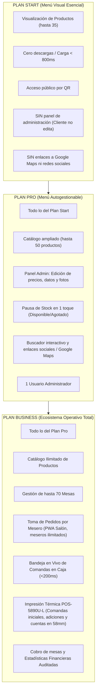

# 📋 ESPECIFICACIÓN DE REQUISITOS DE SOFTWARE (SRS)
## Ecosistema Gastronómico ARSIGEN · Suites Start, Pro & Business

---

### Control del Documento
* **Código:** `ARS-SPEC-SRS-001`
* **Versión:** `1.1.0` (Actualizado según Aclaraciones del Propietario)
* **Estado:** Aprobado para Construcción
* **Fecha:** 2026-11-08
* **Autor:** Josué Caro (ARSIGEN SAS) & Antigravity Lead Architect
* **Metodología:** Spec-Driven Development (SDD) con Trazabilidad Cruzada

---

## 1. Introducción y Alcance del Producto

### 1.1. Propósito
El propósito de este documento es especificar de manera formal, determinista y exhaustiva los requisitos funcionales, no funcionales y de interfaz del ecosistema de software gastronómico de **ARSIGEN**. Este sistema está diseñado para digitalizar la carta, la operación de salón, el despacho a cocina, el cobro en caja y la auditoría estadística de restaurantes, cafeterías, heladerías y bares.

### 1.2. Modelo de Distribución y Arquitectura de Entrega
A diferencia de un SaaS centralizado multi-inquilino en un único dominio, ARSIGEN opera bajo un modelo de **Instancia Aislada Dedicada por Cliente**:
1. Cada establecimiento gastronómico que adquiere el servicio cuenta con su propio proyecto independiente en Google Cloud / Firebase (`negocio.web.app` o dominio propio `.com`).
2. La base de datos, el almacenamiento multimedia y las reglas de seguridad están totalmente aislados por negocio, garantizando confidencialidad absoluta y soberanía de datos.
3. El código fuente opera sobre una **Arquitectura de Motor Único Modular (Single-Core Engine)** gobernado por Banderas de Capacidades (*Feature Flags*), lo que permite que cada plan (`start`, `pro`, `business`) funcione de forma idéntica, reproducible y determinista en cualquier cliente.

---

## 2. Actores y Perfiles del Sistema

| ID de Actor | Nombre del Rol | Descripción y Ámbito de Operación |
|---|---|---|
| **`ACT-DEV`** | **Desarrollador (ARSIGEN)** | Administrador de infraestructura y aprovisionamiento. Cuenta con acceso especial en producción validado por Cloud Functions (sin hardcodear credenciales). Configura y aprovisiona inicialmente el restaurante (categorías iniciales con iconos SVG predefinidos, productos, mesas, usuario administrador y meseros iniciales), y puede modificar el plan contratado (`start` $\leftrightarrow$ `pro` $\leftrightarrow$ `business`) o flags individuales en vivo sin redespliegue. Posee además todas las facultades del Administrador. |
| **`ACT-ADM`** | **Administrador / Dueño** | Propietario o cajero del restaurante. **Existe exactamente un único usuario administrador por establecimiento**. En Plan Pro y Business gestiona categorías, productos, precios y disponibilidad; administra usuarios meseros; recepciona pedidos de salón; despacha comandas hacia la impresora térmica POS-5890U-L; efectúa el cobro de mesas y analiza estadísticas financieras. |
| **`ACT-WTR`** | **Mesero / Personal de Salón** | Operador de salón en celulares o tablets (**sin límite en la cantidad de meseros registrados**). Visualiza el mapa de mesas (vacías/ocupadas), levanta pedidos de comensales, añade notas de preparación, envía comandas a caja y gestiona su historial de turnos. No tiene acceso a precios administrativos ni a cobrar ni a cancelar pedidos. |
| **`ACT-CST`** | **Comensal / Cliente** | Visitante presencial o remoto. Accede a la carta escaneando el código QR de la mesa o ingresando a la URL del local. Visualiza productos, descripciones, fotos y precios actualizados en tiempo real sin necesidad de descargar aplicaciones ni registrarse. No puede crear órdenes en el sistema. |

---

## 3. Matriz de Capacidades y Alcance por Plan

### 3.1. Variantes de Identidad Visual
* **Sin Diseño Temático:** Interfaz estandarizada ARSIGEN, paleta neutra sobria de alto contraste, tipografía del sistema optimizada para máxima velocidad.
* **Con Diseño Temático:** Adaptación visual al manual de marca del restaurante (paleta de colores personalizada, tipografía corporativa, iconografía SVG seleccionada, animaciones de entrada/salida fluidas en tarjetas y modales, y optimización tonal de fotografías gastronómicas).

---

## 4. Requisitos Funcionales Detallados (`[REQ-xxx]`)

### 4.1. Capacidades y Restricciones Específicas por Plan

#### 4.1.A. Especificación Exclusiva del PLAN START
* **`[REQ-PLN-STA-01]` Propósito Estrictamente de Visualización:** Es una página web de consulta digital para el comensal. El cliente **NO cuenta con panel de administración** y no puede editar ningún componente, plato, precio ni imagen de forma autónoma.
* **`[REQ-PLN-STA-02]` Límite de Catálogo Inicial:** Incluye hasta un máximo de **35 productos**, los cuales son dados de alta durante el aprovisionamiento inicial por el Desarrollador (`ACT-DEV`).
* **`[REQ-PLN-STA-03]` Restricción de Módulos:** No incluye enlaces de reseñas a Google Maps, no incluye enlaces a redes sociales, no incluye gestión de mesas, ni meseros, ni toma de pedidos, ni impresión de comandas.
* **`[REQ-PLN-STA-04]` Soporte Mensual:** Las modificaciones de precios o platos (hasta 3 al mes) son ejecutadas exclusivamente por ARSIGEN / Desarrollador como parte del servicio de mantenimiento.

#### 4.1.B. Especificación Exclusiva del PLAN PRO
* **`[REQ-PLN-PRO-01]` Panel de Control Autónomo del Menú:** Incluye acceso al panel de administración para **1 único usuario administrador** (`ACT-ADM`).
* **`[REQ-PLN-PRO-02]` Capacidad de Catálogo:** Permite la carga, edición y gestión de hasta **50 productos** con descripciones, precios actualizados y fotografías.
* **`[REQ-PLN-PRO-03]` Gestión de Disponibilidad en Tiempo Real:** Permite alternar el estado del producto (`disponible: true/false`) para pausar platos agotados al instante.
* **`[REQ-PLN-PRO-04]` Herramientas de Conversión y Búsqueda:** Incorpora buscador interactivo para el comensal, botón directo de reseñas a Google Maps y enlaces a redes sociales corporativas del restaurante.
* **`[REQ-PLN-PRO-05]` Restricciones Operativas:** No incluye gestión de mesas, ni toma de pedidos por meseros, ni impresión de comandas, ni módulo de caja.

#### 4.1.C. Especificación Exclusiva del PLAN BUSINESS
* **`[REQ-PLN-BUS-01]` Catálogo Ilimitado:** Sin restricción artificial de 35 o 50 productos; soporta el menú completo del establecimiento.
* **`[REQ-PLN-BUS-02]` Módulo de Salón y Meseros:** Soporta una cantidad **ilimitada de meseros** (`ACT-WTR`) con autenticación mediante selector de nombre y PIN numérico.
* **`[REQ-PLN-BUS-03]` Gestión de Mesas:** Control de hasta **70 mesas físicas**, con ciclo de vida operativo (Vacía, Sin Imprimir, Ocupada/Impresa).
* **`[REQ-PLN-BUS-04]` Despacho y Caja en Vivo:** Tablero de control de pedidos en tiempo real con recepción en < 200 ms vía listeners de Firestore.
* **`[REQ-PLN-BUS-05]` Impresión Térmica Especializada (POS-5890U-L):** Emisión de comanda inicial de preparación, comanda de adición de nuevas rondas y pre-cuenta/recibo para el cliente.
* **`[REQ-PLN-BUS-06]` Estadísticas Financieras Auditadas:** Análisis de ventas netas reales calculadas estrictamente sobre órdenes pagadas.

---

### 4.2. Módulo de Menú Público del Comensal (Todos los Planes)
* **`[REQ-MNU-01]` Visualización Responsiva y Minimalista:** Presentación de categorías con iconos vectoriales SVG limpios (sin emojis). Se prohíbe el uso de etiquetas visuales decorativas superfluas (`badgeTag` erradicado) para mantener una interfaz elegante y despejada.
* **`[REQ-MNU-02]` Sincronización en Tiempo Real:** Toda mutación en precios o disponibilidad efectuada por el administrador se refleja en el dispositivo del comensal sin refrescar la página.
* **`[REQ-MNU-03]` Precios con IVA Incluido:** Todos los precios exhibidos al comensal ya tienen los impuestos incluidos. El sistema no calcula ni desglosa IVA.
* **`[REQ-MNU-04]` Puerta Secreta de Acceso al Personal (Stealth Trigger):** Tres toques consecutivos en el logo del restaurante en un lapso < 1000 ms despliegan el modal de acceso del personal. Los toques 1 y 2 deben ser estrictamente inertes (sin respuesta visual, hover ni animación).

---

### 4.3. Módulo Administrativo de Carta (Planes Pro y Business)
* **`[REQ-ADM-01]` Autenticación Segura:** El administrador inicia sesión mediante Google OAuth o credenciales de correo/contraseña.
* **`[REQ-ADM-02]` Edición de Catálogo dentro del Límite del Plan:** El administrador puede crear, editar y eliminar categorías y productos dentro de la cuota autorizada (hasta 50 en Pro, ilimitado en Business). En Plan Start esta función está completamente bloqueada.
* **`[REQ-ADM-03]` Iconografía Vectorial SVG en Categorías:** Las categorías utilizan exclusivamente iconos SVG estandarizados provistos por el sistema. No se permiten emojis.
* **`[REQ-ADM-04]` Uso Interno de `sortOrder`:** El ordenamiento numérico de productos y categorías es de uso interno del sistema; su numeración jamás se expone al comensal.
* **`[REQ-ADM-05]` Inmutabilidad y Catálogo Unificado:** Cuando el administrador modifique el precio de un producto, dicho precio rige de inmediato tanto para el menú del comensal como para el menú de pedidos del mesero a partir de ese momento. No altera las órdenes emitidas con anterioridad.

---

### 4.4. Módulo de Salón y Flujo de Creación de Orden del Mesero (Plan Business)
* **`[REQ-WTR-01]` Autenticación Ágil por PIN:** Los meseros inician sesión seleccionando su nombre y digitando un PIN numérico de 4 a 6 dígitos asignado por el administrador.
* **`[REQ-WTR-02]` Mapa de Mesas Binario:** La pantalla del mesero solo visualiza dos estados operativos:
  * **Vacía (Verde):** Disponible para apertura de pedido.
  * **Ocupada (Rojo/Ámbar):** Mesa con comensales y comanda activa.
* **`[REQ-WTR-03] Flujo Estructurado de Creación de Orden en 3 Espacios:`**  
  Al presionar sobre una mesa, se abre la interfaz de comanda estructurada estrictamente en 3 zonas ergonómicas:
  1. **Espacio 1 — Barra de Búsqueda (Zona Superior):**  
     Campo de texto predictivo que permite al mesero teclear el nombre de cualquier producto. Despliega al instante una lista flotante de coincidencias para seleccionarlo con un toque.
  2. **Espacio 2 — Sección de Productos Seleccionados (Zona Central):**  
     Bandeja interactiva donde se acumulan los ítems elegidos. Cada renglón muestra el nombre del producto, contador táctil de cantidad (`-` / `+`), subtotal calculado y un botón para abrir el campo de notas de preparación (*"sin cebolla"*, *"término 3/4"*). Permite eliminar ítems antes de enviar.
  3. **Espacio 3 — Selector de Categorías (Zona Inferior):**  
     Banda inferior con las categorías del restaurante representadas por sus iconos SVG y nombres. Si el mesero no utiliza la barra de búsqueda superior, navega por estas categorías y toca productos que se suman automáticamente a la sección central.
* **`[REQ-WTR-04]` Despacho a Caja:** Al presionar *"Enviar a Cocina"*, el pedido se registra en `/orders` con estado inicial `sin_imprimir` y registra la marca de tiempo exacta `createdAt`.
* **`[REQ-WTR-05]` Adición a Mesas Ocupadas:** Si una mesa ya tiene comanda activa y se solicita una nueva ronda, el mesero ingresa a la mesa, añade los nuevos platos y los despacha. El sistema los etiqueta con `isAddedRound: true` y la mesa se notifica a caja como adición pendiente de imprimir.
* **`[REQ-WTR-06]` Cambio de Mesa:** El mesero puede transferir una comanda abierta de su mesa actual hacia otra mesa que se encuentre estrictamente vacía.
* **`[REQ-WTR-07]` Pedido de Personal ("A su nombre"):** Opción directa para registrar consumos internos del personal sin asignación obligatoria de mesa física.
* **`[REQ-WTR-08]` Restricción de Anulación y Cobro:** El mesero tiene prohibido borrar órdenes o marcarlas como pagadas. Solo el administrador posee esta atribución.

---

### 4.5. Módulo de Despacho y Caja en Tiempo Real (Plan Business)
* **`[REQ-KDS-01]` Tablero de Control de Mesas de Caja:** El administrador visualiza las mesas categorizadas en tres estados:
  * **Vacía:** Sin pedidos activos.
  * **Sin Imprimir (Alerta Visual Destacada):** Pedido recién entrado del mesero; requiere emisión de comanda para cocina.
  * **Ocupada / Impresa:** Comanda en preparación física en cocina/barra.
* **`[REQ-KDS-02]` Recepción en Tiempo Real (< 200 ms):** El panel de caja escucha cambios mediante listeners activos (`onSnapshot`). Cuando un mesero pulsa *"Enviar"*, la mesa en caja cambia de estado de forma reactiva sin refrescar la página.
* **`[REQ-KDS-03]` Impresión de Comanda Inicial:** Al presionar *"Imprimir Comanda"*, el sistema envía los comandos ESC/POS a la POS-5890U-L, registra el timestamp `printedAt` y la mesa transiciona a estado `ocupada`.
* **`[REQ-KDS-04]` Impresión de Comanda de Adición:** Si una mesa recibe platos adicionales en una segunda ronda, el botón de caja emite exclusivamente el ticket rotulado como `*** ADICIÓN / RONDA ***` conteniendo únicamente los ítems agregados recientemente.
* **`[REQ-KDS-05]` Emisión de Pre-cuenta al Cliente:** Al solicitar la cuenta la mesa, el administrador pulsa *"Imprimir Cuenta"*, emitiendo el ticket detallado con precios unitarios, subtotal y total (sin desglose de IVA).
* **`[REQ-KDS-06]` Cierre y Cobro de Mesa:** El administrador pulsa *"Marcar como Pagado"*, registrando el método de pago (Efectivo, Tarjeta, Transferencia), registrando el timestamp `paidAt`, cerrando la orden y liberando la mesa a estado `vacía`.

---

### 4.6. Módulo Estadístico y Financiero (Plan Business)
* **`[REQ-STA-01]` Segregación Estricta de Datos:** Las estadísticas deben calcularse **única y exclusivamente sobre órdenes con `status == 'paid'`**. Se prohíbe computar pedidos en curso, anulados o mesas activas.
* **`[REQ-STA-02]` Métricas Financieras Libres de Impuestos:**
  * Ventas brutas del día en moneda local (suma de totales pagados con IVA incluido).
  * Ticket promedio por mesa atendida.
  * Ventas acumuladas en el mes calendario.
* **`[REQ-STA-03]` Métricas Operativas y de Rotación:**
  * Ranking de productos más vendidos por volumen de unidades y por facturación monetaria.
  * Distribución de volumen de ventas por día de la semana (Lunes a Domingo).
  * Ventas y pedidos atendidos por cada mesero para control de desempeño.

---

## 5. Requisitos No Funcionales (`[NFR-xxx]`)

### 5.1. Rendimiento y Velocidad (`[NFR-PER]`)
* **`[NFR-PER-01]` Tiempo de Carga Inicial (LCP):** El menú público del comensal debe renderizarse en menos de **800 ms** bajo conexiones móviles 4G.
* **`[NFR-PER-02]` Latencia de Sincronización:** La propagación de un pedido desde el móvil del mesero hasta la pantalla de caja no debe exceder los **300 ms**.
* **`[NFR-PER-03]` Tamaño del Bundle:** El código JavaScript del cliente no debe superar los 180 KB en su primera carga optimizada mediante *Code Splitting* y compresión Gzip/Brotli.

### 5.2. Confiabilidad y Tolerancia a Fallos (`[NFR-REL]`)
* **`[NFR-REL-01]` Persistencia Offline en Salón:** Si el mesero pierde la señal Wi-Fi mientras recorre las mesas, Firestore mantendrá la orden en caché IndexedDB local y la despachará automáticamente al reconectarse.
* **`[NFR-REL-02]` Manejo de Errores de Impresora:** Si la POS-5890U-L se desconecta o carece de papel, la aplicación no debe bloquearse; debe alertar al usuario y ofrecer reintento inmediato o conmutación al diálogo de impresión del sistema.
* **`[NFR-REL-03]` Concurrencia Atómica:** Dos meseros no pueden abrir simultáneamente la misma mesa; el sistema debe usar transacciones de Firestore para garantizar un único dueño de comanda por mesa.

### 5.3. Seguridad y Control de Acceso (`[NFR-SEC]`)
* **`[NFR-SEC-01]` Inmutabilidad Absoluta de Órdenes Pagadas:** Una vez que una orden es marcada como `paid`, queda permanentemente congelada. Queda prohibida cualquier edición o eliminación en la base de datos, incluso para el Administrador o el Desarrollador.
* **`[NFR-SEC-02]` Sesión Única Concurrente:** Si un usuario (Administrador o Mesero) inicia sesión en un dispositivo nuevo, cualquier sesión previa en otro terminal debe ser desalojada de forma instantánea.
* **`[NFR-SEC-03]` Autenticación Global de Desarrollador:** La validación del rol de Desarrollador se realiza a nivel de Cloud Functions mediante tokens de Google OAuth, sin almacenar direcciones de correo en duro (*hardcodeadas*) en el frontend.

---

## 6. Matriz de Trazabilidad Cruzada

| Requisito Funcional | Regla de Negocio Vinculada | Entidad de Base de Datos | Componente Arquitectónico |
|---|---|---|---|
| `[REQ-PLN-STA-01]` Solo visualización Start | `[BR-PLN-01]` Bloqueo de admin en Start | `/config/general.plan` | RouteGuard & Capabilities |
| `[REQ-WTR-03]` Flujo de orden en 3 espacios | `[BR-ORD-01]` Creación de comanda | `/orders`, `/tables` | `<OrderDrawer />` |
| `[REQ-MNU-04]` Puerta Secreta 3 Toques | `[BR-SEC-01]` Toques silenciosos | `/users` | `<SecretAccessTrigger />` |
| `[REQ-ADM-05]` Inmutabilidad de Precios | `[BR-PRC-01]` Snapshot de precio | `/orders.items[]` | `createOrderSnapshot()` |
| `[REQ-KDS-04]` Comanda de Adición | `[BR-PRT-02]` Plantillas ESC/POS | `/orders.items[].isAddedRound` | `EscPosFormatter.ts` |
| `[REQ-STA-01]` Estadísticas solo Pagados | `[BR-STA-01]` Filtro estricto de caja | `/orders` (`status=='paid'`) | `AnalyticsCalculator.ts` |
| `[REQ-SEC-01]` Inmutabilidad Pagadas | `[BR-ORD-03]` Congelación final | `/orders` (`status=='paid'`) | `firestore.rules` (delete=false) |
