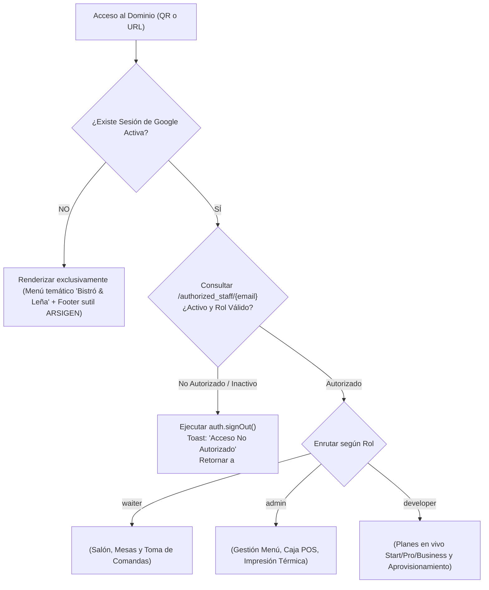

# 🏛️ ESPECIFICACIÓN DE ARQUITECTURA DE SOFTWARE (SAS)
## Arquitectura del Motor Gastronómico ARSIGEN · Single-Core Modular
### Plantilla Base: "Bistró & Leña · Fuego Sagrado"

---

### Control del Documento
* **Código:** `ARS-SPEC-SAS-002`
* **Versión:** `1.2.0` (Alineado con Iteración 1: Software Cerrado, Auth Google Whitelist & Motion System)
* **Estado:** Aprobado para Construcción
* **Fecha:** 2026-11-09
* **Autor:** Josué Caro (ARSIGEN SAS) & Antigravity Lead Architect
* **Trazabilidad:** Derivado de `ARS-SPEC-SRS-001`
* **Diagramas Relacionados:** [DIAGRAM_SEQUENCE.md](file:///c:/Users/JOSUE/PROYECTOS/Plantilla%20Arsigen/DIAGRAM_SEQUENCE.md) y [DIAGRAM_FLOWCHARTS_AND_STATES.md](file:///c:/Users/JOSUE/PROYECTOS/Plantilla%20Arsigen/DIAGRAM_FLOWCHARTS_AND_STATES.md)

---

## 1. Visión General de la Arquitectura y Patrones de Diseño

El sistema opera bajo los patrones **Clean Architecture**, **Modular Monolith** desacoplado en cliente e **Instancia Aislada Dedicada** en la nube:

```
┌───────────────────────────────────────────────────────────────────────────┐
│                           CAPA DE PRESENTACIÓN (UI)                       │
│  [ Menú Comensal Bistró ]   [ PWA Meseros (Google Auth) ]   [ Caja & POS ]│
│               [ Consola de Infraestructura Desarrollador ]                │
└─────────────────────────────────────┬─────────────────────────────────────┘
                                      │
┌─────────────────────────────────────▼─────────────────────────────────────┐
│                 CAPA DE ENRUTAMIENTO CERRADO Y WHITELIST                  │
│  [ Stealth Gatekeeper ]  [ Auth Whitelist Guard ]  [ Dynamic Capabilities]│
└─────────────────────────────────────┬─────────────────────────────────────┘
                                      │
┌─────────────────────────────────────▼─────────────────────────────────────┐
│                    CAPA DE SERVICIOS & DRIVERS DE HARDWARE                │
│  [ ESC/POS Web Bluetooth ]   [ WebUSB / Serial ]   [ Firestore Services ] │
└─────────────────────────────────────┬─────────────────────────────────────┘
                                      │
┌─────────────────────────────────────▼─────────────────────────────────────┐
│                         INFRAESTRUCTURA CLOUD DEDICADA                    │
│   Firebase Auth   │   Cloud Functions   │   Cloud Firestore   │  Hosting  │
└───────────────────────────────────────────────────────────────────────────┘
```

---

## 2. Enrutamiento Estricto de Software Cerrado y Gatekeeper de Personal

A diferencia de las arquitecturas SaaS convencionales, el componente raíz `App.tsx` no renderiza selectores de perspectiva ni enlaces administrativos al usuario general:



### 2.1. Puerta de Acceso Discreta (Stealth Trigger)
* Los comensales no ven botones de login.
* El personal activa el modal de Google OAuth realizando **3 toques consecutivos sobre el logo del restaurante en menos de 1000 ms**.
* Los toques 1 y 2 permanecen inertes (sin animaciones ni sonidos) para evitar que los comensales descubran el mecanismo.

---

## 3. Matriz de Capacidades Dinámicas del Motor Único (`capabilities.ts`)

```ts
export type PlanTier = 'start' | 'pro' | 'business';

export interface PlanCapabilities {
  tier: PlanTier;
  allowAdminMenuEdit: boolean;   // true en Pro y Business | false en Start
  allowStockToggle: boolean;      // true en Pro y Business | false en Start
  allowWaiterModule: boolean;     // Solo true en Business
  allowKitchenComandas: boolean;  // Solo true en Business
  allowThermalPrinter: boolean;   // Solo true en Business
  allowFinancialStats: boolean;   // Solo true en Business
  allowSocialLinks: boolean;      // true en Pro y Business | false en Start
  allowGoogleMapsReview: boolean; // true en Pro y Business | false en Start
  maxProducts: number;            // 35 en Start, 50 en Pro, ilimitado en Business
  maxTables: number;              // 0 en Start y Pro, 70 en Business
}

export const CAPABILITIES: Record<PlanTier, PlanCapabilities> = {
  start: {
    tier: 'start',
    allowAdminMenuEdit: false,
    allowStockToggle: false,
    allowWaiterModule: false,
    allowKitchenComandas: false,
    allowThermalPrinter: false,
    allowFinancialStats: false,
    allowSocialLinks: false,
    allowGoogleMapsReview: false,
    maxProducts: 35,
    maxTables: 0,
  },
  pro: {
    tier: 'pro',
    allowAdminMenuEdit: true,
    allowStockToggle: true,
    allowWaiterModule: false,
    allowKitchenComandas: false,
    allowThermalPrinter: false,
    allowFinancialStats: false,
    allowSocialLinks: true,
    allowGoogleMapsReview: true,
    maxProducts: 50,
    maxTables: 0,
  },
  business: {
    tier: 'business',
    allowAdminMenuEdit: true,
    allowStockToggle: true,
    allowWaiterModule: true,
    allowKitchenComandas: true,
    allowThermalPrinter: true,
    allowFinancialStats: true,
    allowSocialLinks: true,
    allowGoogleMapsReview: true,
    maxProducts: 9999,
    maxTables: 70,
  },
};
```

---

## 4. Arquitectura de Motion Graphics y Diseño Editorial ("Bistró & Leña")

Para ofrecer una experiencia culinaria premium que rompa con las interfaces genéricas:
1. **Física de Deslizamiento Lateral (Horizontal Scroll Kinetics):**
   * El carrusel de categorías y los cortes de la casa utilizan `overflow-x: auto` con snap por elementos (`scroll-snap-type: x mandatory`).
   * Deslizamiento inercial suave sin barras de scroll invasivas del navegador (`scrollbar-width: none`).
2. **Sistema de Entrada y Salida Suave (Staggered Motion Tokens):**
   * Todo modal, producto o menú desplegable cuenta con una curva de transición formal:
     $$\text{easeOutCubic} = [0.16, 1, 0.3, 1]$$
   * Entrada: `translateY(16px) -> translateY(0px)`, `opacity: 0 -> 1` con duración de 280 ms.
   * Salida: `opacity: 1 -> 0`, `scale: 1 -> 0.98` con duración de 200 ms. Ningún elemento desaparece de golpe.
3. **Composición Orgánica sin Contenedores Cuadrados:**
   * La información no se encierra en rectángulos aislados con bordes duros.
   * Se utiliza tipografía jerárquica con espacio negativo (*whitespace*), líneas divisoras sutiles con gradiente ahumado y fondos con resplandor cálido difuso (*amber glow blur-3xl*).

---

## 5. Formatos y Plantillas de Impresión Térmica (POS-5890U-L · 58 mm / 32 Columnas)

El ancho imprimible es de exactamente **32 caracteres monoespaciados por línea**.

### 5.1. Plantilla 1: Comanda Inicial de Cocina / Barra (Preparación)
```
0        1         2         3  
12345678901234567890123456789012
================================
*** COMANDA COCINA / BRASA ***
================================
ORDEN: #0142         HORA: 14:35
MESA: 05         MESERO: Carlos
--------------------------------
CANT  DESCRIPCION
--------------------------------
 2    Bife de Chorizo Angus
      * Termino 3/4
      * Papa rustica al romero
 1    Costillas Ahumadas Leña
 2    Cerveza IPA Artesanal
================================
```

### 5.2. Plantilla 2: Comanda de Adición (Segunda Ronda)
```
0        1         2         3  
12345678901234567890123456789012
================================
***  COMANDA DE ADICION  ***
***   RONDA ADICIONAL    ***
================================
ORDEN: #0142         HORA: 15:10
MESA: 05         MESERO: Carlos
--------------------------------
CANT  DESCRIPCION (NUEVOS)
--------------------------------
 2    Coctel Fuego Ahumado
 1    Papas Trufadas al Carbon
================================
```

### 5.3. Plantilla 3: Pre-cuenta / Recibo del Cliente
```
0        1         2         3  
12345678901234567890123456789012
================================
  BISTRO & LEÑA · FUEGO SAGRADO 
       NIT: 901.482.119-3       
================================
MESA: 05             ORDEN #0142
MESERO: Carlos       HORA: 15:45
--------------------------------
CANT  PRODUCTO             TOTAL
--------------------------------
 2    Bife de Chorizo    $96.000
 1    Costillas Ahumadas $54.000
 2    Cerveza IPA        $28.000
 2    Coctel Ahumado     $42.000
 1    Papas Trufadas     $18.000
--------------------------------
SUBTOTAL (IVA Incluido):$238.000
PROPINA SUGERIDA (10%):  $23.800
--------------------------------
TOTAL A PAGAR:          $261.800
================================
  Comprobante de consumo interno
  No valido como factura fiscal 
================================
```

---

## 6. Diagramas de Secuencia y Flujo de Procesos
Para una revisión gráfica exhaustiva de las secuencias operativas, consultar los documentos técnicos dedicados:
* [DIAGRAM_SEQUENCE.md](file:///c:/Users/JOSUE/PROYECTOS/Plantilla%20Arsigen/DIAGRAM_SEQUENCE.md): Handshake de autenticación, toma de comanda por mesero en 3 espacios ergonómicos, listener de caja, impresión térmica e inmutabilidad de órdenes pagadas.
* [DIAGRAM_FLOWCHARTS_AND_STATES.md](file:///c:/Users/JOSUE/PROYECTOS/Plantilla%20Arsigen/DIAGRAM_FLOWCHARTS_AND_STATES.md): Máquinas de estado de mesas y órdenes, junto con la gestión de fallos de red e impresora.
