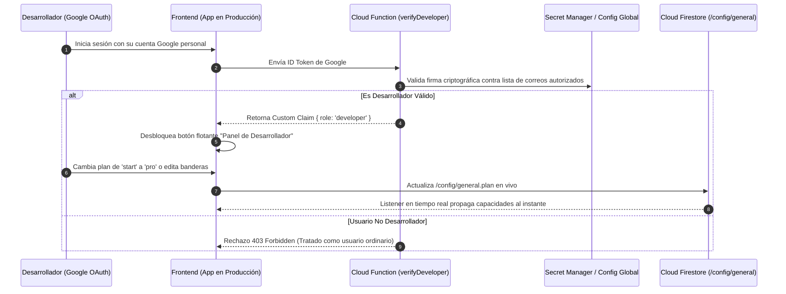
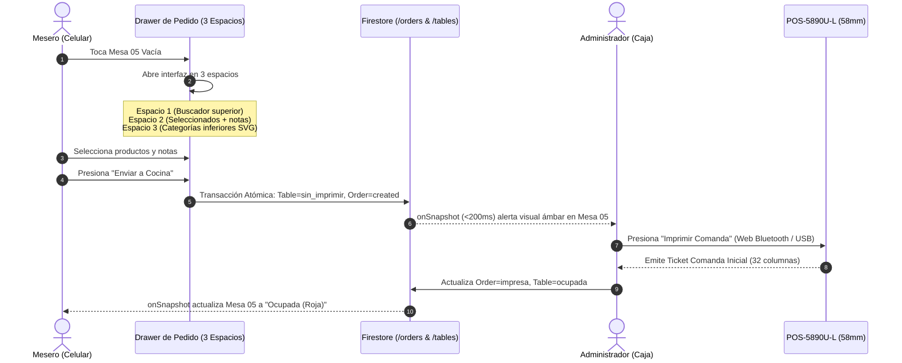
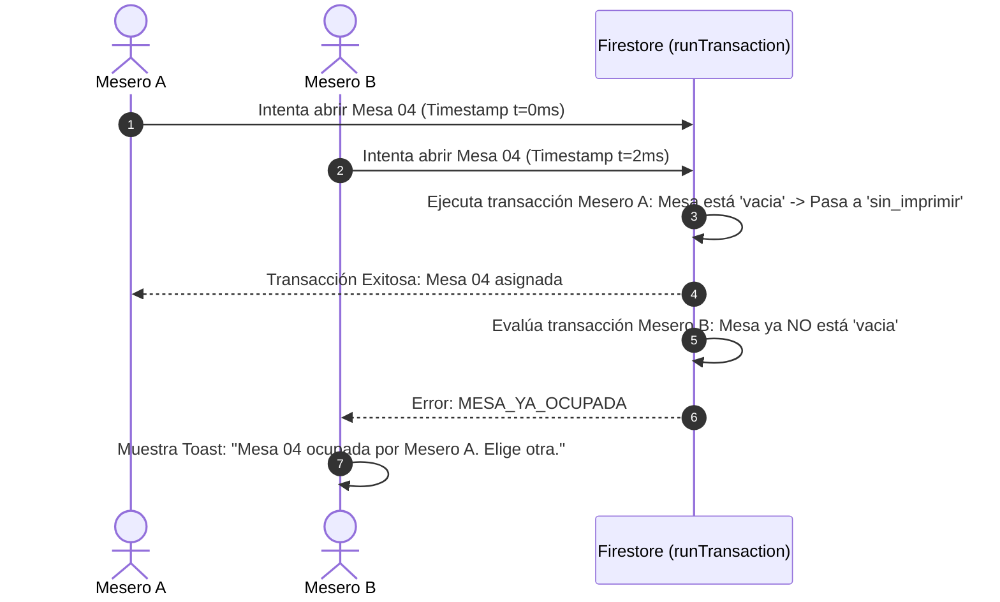

# 🏛️ ESPECIFICACIÓN DE ARQUITECTURA DE SOFTWARE (SAS)
## Arquitectura del Motor Gastronómico ARSIGEN · Single-Core Modular

---

### Control del Documento
* **Código:** `ARS-SPEC-SAS-002`
* **Versión:** `1.1.0` (Actualizado según Aclaraciones del Propietario)
* **Estado:** Aprobado para Construcción
* **Fecha:** 2026-11-08
* **Autor:** Josué Caro (ARSIGEN SAS) & Antigravity Lead Architect
* **Trazabilidad:** Derivado de `ARS-SPEC-SRS-001`

---

## 1. Visión General de la Arquitectura y Patrones de Diseño

El sistema está diseñado bajo el patrón **Clean Architecture** y **Modular Monolith** desacoplado en el cliente, apoyado en una infraestructura serverless en la nube:

```
┌───────────────────────────────────────────────────────────────────────────┐
│                           CAPA DE PRESENTACIÓN (UI)                       │
│  [ Menú Comensal ]   [ PWA Meseros (Salón) ]   [ Tablero Caja & Métricas ]│
│               [ Panel de Desarrollador en Producción ]                    │
└─────────────────────────────────────┬─────────────────────────────────────┘
                                      │
┌─────────────────────────────────────▼─────────────────────────────────────┐
│                       CAPA DE DOMINIO & FEATURE FLAGS                     │
│  [ DynamicCapabilityMatrix ]  [ StateMachine: Mesas ]  [ Snapshot Engine ]│
└─────────────────────────────────────┬─────────────────────────────────────┘
                                      │
┌─────────────────────────────────────▼─────────────────────────────────────┐
│                    CAPA DE SERVICIOS & DRIVERS DE HARDWARE                │
│  [ ESC/POS Web Bluetooth ]   [ WebUSB / Serial ]   [ Firestore Services ] │
└─────────────────────────────────────┬─────────────────────────────────────┘
                                      │
┌─────────────────────────────────────▼─────────────────────────────────────┐
│                         INFRAESTRUCTURA CLOUD DEDICADA                    │
│   Firebase Auth   │   Cloud Functions   │   Cloud Firestore   │  Hosting  │
└───────────────────────────────────────────────────────────────────────────┘
```

### 1.1. Motor Único con Matriz de Capacidades Dinámicas
Cada instancia cuenta con una configuración viva alojada en `/config/general`. El archivo `capabilities.ts` mapea el plan (`start`, `pro`, `business`) y las banderas activas en tiempo real:

```ts
// src/config/capabilities.ts
export type PlanTier = 'start' | 'pro' | 'business';

export interface PlanCapabilities {
  tier: PlanTier;
  allowAdminMenuEdit: boolean;   // true en Pro y Business | false en Start
  allowStockToggle: boolean;      // true en Pro y Business | false en Start
  allowWaiterModule: boolean;     // Solo true en Business
  allowKitchenComandas: boolean;  // Solo true en Business
  allowThermalPrinter: boolean;   // Solo true en Business
  allowFinancialStats: boolean;   // Solo true en Business
  allowSocialLinks: boolean;      // true en Pro y Business | false en Start
  allowGoogleMapsReview: boolean; // true en Pro y Business | false en Start
  maxProducts: number;            // 35 en Start, 50 en Pro, ilimitado en Business
  maxTables: number;              // 0 en Start y Pro, 70 en Business
}

export const CAPABILITIES: Record<PlanTier, PlanCapabilities> = {
  start: {
    tier: 'start',
    allowAdminMenuEdit: false,
    allowStockToggle: false,
    allowWaiterModule: false,
    allowKitchenComandas: false,
    allowThermalPrinter: false,
    allowFinancialStats: false,
    allowSocialLinks: false,
    allowGoogleMapsReview: false,
    maxProducts: 35,
    maxTables: 0,
  },
  pro: {
    tier: 'pro',
    allowAdminMenuEdit: true,
    allowStockToggle: true,
    allowWaiterModule: false,
    allowKitchenComandas: false,
    allowThermalPrinter: false,
    allowFinancialStats: false,
    allowSocialLinks: true,
    allowGoogleMapsReview: true,
    maxProducts: 50,
    maxTables: 0,
  },
  business: {
    tier: 'business',
    allowAdminMenuEdit: true,
    allowStockToggle: true,
    allowWaiterModule: true,
    allowKitchenComandas: true,
    allowThermalPrinter: true,
    allowFinancialStats: true,
    allowSocialLinks: true,
    allowGoogleMapsReview: true,
    maxProducts: 9999,
    maxTables: 70,
  },
};
```

---

## 2. Autenticación Global del Desarrollador y Gestión de Planes en Producción

Para evitar redespliegues o cambios manuales de código fuente cuando un cliente adquiere un servicio o cambia de plan:



* **Cero Credenciales Hardcodeadas:** El correo del desarrollador **no reside en el código fuente de Git**. La validación reside en una Cloud Function serverless que consulta una variable secreta en el proyecto.
* **Aprovisionamiento Inicial:** Desde este panel, el Desarrollador crea el único usuario Administrador (`ACT-ADM`), las categorías iniciales con sus iconos SVG correspondientes, el catálogo de platos iniciales y las mesas sin requerir acceso a la consola de Firebase.

---

## 3. Formatos y Plantillas de Impresión Térmica (POS-5890U-L · 58 mm / 32 Columnas)

El ancho imprimible es de 48 mm (exactamente **32 caracteres monoespaciados por línea** en Font A).

### 3.1. Plantilla 1: Comanda Inicial de Cocina / Barra (Preparación)
No muestra ningún valor monetario ni precios; únicamente cantidades, nombres de platos y notas con sangría:

```
0        1         2         3  
12345678901234567890123456789012
================================
*** COMANDA COCINA / BARRA ***
================================
ORDEN: #0142         HORA: 14:35
MESA: 05         MESERO: Carlos
--------------------------------
CANT  DESCRIPCION
--------------------------------
 2    Hamburguesa Doble
      * Sin cebolla
      * Termino 3/4
 1    Papas Rusticas Especial
 2    Limonada de Coco
================================
```

---

### 3.2. Plantilla 2: Comanda de Adición de Productos (Segunda Ronda o Posterior)
Se emite **únicamente con los platos nuevos** añadidos por el mesero tras haber despachado la comanda inicial:

```
0        1         2         3  
12345678901234567890123456789012
================================
***  COMANDA DE ADICION  ***
***   RONDA ADICIONAL    ***
================================
ORDEN: #0142         HORA: 15:10
MESA: 05         MESERO: Carlos
--------------------------------
CANT  DESCRIPCION (NUEVOS)
--------------------------------
 2    Cerveza Artesanal IPA
 1    Porcion de Papas Francesa
================================
```

---

### 3.3. Plantilla 3: Pre-cuenta / Recibo del Cliente
Contiene el membrete del local, los valores económicos con **IVA ya incluido** (sin desglose de impuestos), propina voluntaria sugerida y la leyenda fiscal obligatoria:

```
0        1         2         3  
12345678901234567890123456789012
================================
      SABOR ARTESANAL REST      
       NIT: 901.482.119-3       
================================
MESA: 05             ORDEN #0142
MESERO: Carlos       HORA: 15:45
--------------------------------
CANT  PRODUCTO             TOTAL
--------------------------------
 2    Hamburguesa Doble  $44.000
 1    Papas Rusticas     $12.000
 2    Limonada de Coco   $22.000
 2    Cerveza Artesanal  $24.000
 1    Papas Francesa      $8.000
--------------------------------
SUBTOTAL (IVA Incluido):$110.000
PROPINA SUGERIDA (10%):  $11.000
--------------------------------
TOTAL A PAGAR:          $121.000
================================
 Comprobante de consumo interno 
 No valido como factura fiscal  
================================
```

---

## 4. Diagramas de Secuencia y Flujos Operativos

### 4.1. Flujo de Creación de Orden del Mesero (3 Espacios) y Recepción en Caja



### 4.2. Bloqueo Concurrente de Mesas (Race Condition Prevention)



---

## 5. Resiliencia & Tolerancia a Fallos del Ecosistema

1. **Modo Offline en Salón:** Gracias a `persistentLocalCache`, el mesero no detiene su trabajo si la señal Wi-Fi cae; las comandas se encolan en IndexedDB y se despachan de forma atómica en cuanto la red regresa.
2. **Atasco / Desconexión de Impresora:** Si la POS-5890U-L se apaga o agota el rollo, la orden no se cancela ni se pierde; permanece marcada como `sin_imprimir` con un modal de contingencia para reintentar tras colocar el rollo nuevo o imprimir por pantalla.
3. **Inmutabilidad Absoluta:** Ningún usuario (incluyendo al Administrador y al Desarrollador) puede modificar ni eliminar una orden cuyo estado sea `paid`.
4. **Desalojo Concurrente de Sesión:** Si un mesero o admin abre su cuenta en un segundo teléfono, el listener del `currentSessionId` en el primer teléfono cierra sesión inmediatamente (`auth.signOut()`).
