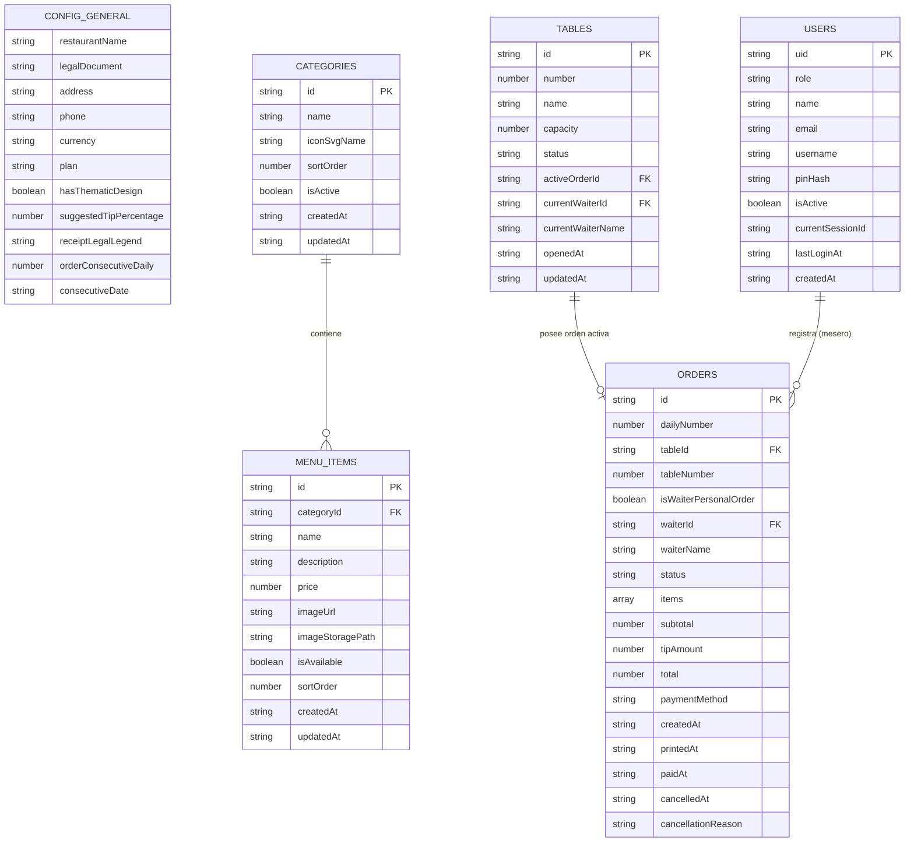

# 💾 ESPECIFICACIÓN DE BASE DE DATOS (DBS)
## Modelo de Datos Cloud Firestore · Instancia Autónoma Gastronómica

---

### Control del Documento
* **Código:** `ARS-SPEC-DBS-003`
* **Versión:** `1.1.0` (Actualizado según Aclaraciones del Propietario)
* **Estado:** Aprobado para Construcción
* **Fecha:** 2026-11-08
* **Autor:** Josué Caro (ARSIGEN SAS) & Antigravity Lead Architect
* **Trazabilidad:** Derivado de `ARS-SPEC-SRS-001` y `ARS-SPEC-SAS-002`

---

## 1. Visión General y Diagrama Entidad-Relación (ERD)

El motor de ARSIGEN utiliza **Google Cloud Firestore** (modo nativo NoSQL) en cada proyecto individual de Firebase. La arquitectura de datos está diseñada para:
1. **Consumo Eficiente de Lecturas/Escrituras:** Mantiene la facturación del restaurante dentro de la capa gratuita o ultra-económica de Firebase.
2. **Consultas en Tiempo Real de Baja Latencia:** Optimizado para listeners `onSnapshot` sin escaneo masivo de documentos.
3. **Inmutabilidad Financiera:** Aplicación estricta del patrón *Snapshotting* en transacciones monetarias sin cálculos ni desgloses de impuestos (los precios de los menús ya contemplan el IVA).

### 1.1. Diagrama Entidad-Relación (Mermaid ERD)



---

## 2. Definición Detallada de Colecciones y Esquemas TypeScript

### 2.1. Colección `/config/general`
Documento singleton que define los parámetros operativos, la identidad del restaurante y el plan activo.

```ts
export interface RestaurantConfig {
  restaurantName: string;            // Ej: "Sabor Artesanal"
  legalDocument: string;             // NIT o RUT (Ej: "901.482.119-3")
  address: string;                   // Dirección física para el pie del ticket
  phone: string;                     // Celular para contacto / pedidos
  currency: 'COP' | 'USD';           // Moneda de operación
  plan: 'start' | 'pro' | 'business';// Plan activo en la instancia (editable en vivo por el desarrollador)
  hasThematicDesign: boolean;        // true si pagó diseño de autor
  settings: {
    suggestedTipPercentage: number;  // Ej: 10 (propina voluntaria sugerida)
    receiptLegalLegend: string;      // "Comprobante de consumo interno / No válido como factura fiscal"
    orderConsecutiveDaily: number;   // Consecutivo numérico diario (reinicia a 1 a medianoche)
    consecutiveDate: string;         // YYYY-MM-DD para control del reinicio de consecutivo
  };
  socialLinks?: {                    // Bloqueado / Inexistente en Plan Start; disponible en Pro y Business
    whatsappUrl?: string;
    googleMapsReviewUrl?: string;
    instagramUrl?: string;
  };
  updatedAt: string;                 // ISO 8601 Timestamp
}
```

> **Aclaración de Impuestos:** Todos los precios del menú ya incluyen el IVA. El sistema erradica cualquier campo tipo `taxPercentage`, `pricesIncludeTax` o `taxAmount`. Este es un software operativo sin impacto tributario ni contable.

---

### 2.2. Colección `/categories`
Agrupadores del menú (Entradas, Platos Fuertes, Bebidas, etc.).

```ts
export interface MenuCategory {
  id: string;                        // Identificador único (auto-generado)
  name: string;                      // Nombre visual (Ej: "Pizzas Artesanales")
  iconSvgName: string;               // Nombre del icono SVG vectorial predefinido (Ej: "pizza", "burger", "drink"). EMOJIS PROHIBIDOS.
  sortOrder: number;                 // Orden numérico interno de despliegue (Uso estrictamente interno, jamás visible al comensal)
  isActive: boolean;                 // Permite ocultar temporalmente una categoría entera
  createdAt: string;                 // ISO 8601 Timestamp
  updatedAt: string;                 // ISO 8601 Timestamp
}
```

---

### 2.3. Colección `/menu_items`
Catálogo vivo de productos. Tanto comensales como meseros consultan exactamente esta misma colección.

```ts
export interface MenuItem {
  id: string;                        // Identificador único
  categoryId: string;                // Referencia a /categories/{categoryId}
  name: string;                      // Nombre del producto
  description: string;               // Ingredientes y descripción apetitosa
  price: number;                     // Precio vigente en moneda local con IVA incluido (Ej: 22000)
  imageUrl: string;                  // URL pública en Firebase Storage (o SVG fallback)
  imageStoragePath?: string;         // Ruta interna en Storage para borrado físico
  isAvailable: boolean;              // true: Disponible en carta | false: Agotado / Pausado
  sortOrder: number;                 // Orden numérico interno de visualización (Oculto al comensal)
  createdAt: string;                 // ISO 8601 Timestamp
  updatedAt: string;                 // ISO 8601 Timestamp
}
```

> **Aclaración de Minimalismo:** Se elimina por completo el campo `badgeTag`. La interfaz prescinde de etiquetas decorativas para mantener un diseño visual despejado, limpio y elegante.

---

### 2.4. Colección `/tables` (Plan Business)
Estado en tiempo real de cada mesa física del local (hasta 70 mesas).

```ts
export type TableStatus = 'vacia' | 'sin_imprimir' | 'ocupada';

export interface RestaurantTable {
  id: string;                        // Ej: "table_01", "table_02"
  number: number;                    // Número visible de la mesa (Ej: 1, 2, 3... 70)
  name: string;                      // Etiqueta (Ej: "Mesa 01", "Barra 02", "Terraza 05")
  capacity: number;                  // Cantidad estimada de comensales (Ej: 4)
  status: TableStatus;               // Estado tripartito de caja
  activeOrderId: string | null;      // ID de la orden en curso (null si está vacía)
  currentWaiterId: string | null;    // ID del mesero que abrió la mesa
  currentWaiterName: string | null;  // Nombre del mesero para visualización rápida
  openedAt: string | null;           // Momento en que se sentaron los comensales
  updatedAt: string;                 // Última mutación (en milisegundos)
}
```

#### Mapeo de Perspectivas de Interfaz:
* **Para el Mesero (Perspectiva Binaria):**
  * Si `status == 'vacia'` $\rightarrow$ Renderiza botón **Verde (Disponible)**.
  * Si `status == 'sin_imprimir'` o `status == 'ocupada'` $\rightarrow$ Renderiza botón **Rojo/Ámbar (Ocupada)**.
* **Para el Administrador en Caja (Perspectiva Operativa):**
  * Renderiza los 3 estados: Verde (`vacia`), Ámbar Pulsante (`sin_imprimir`), Azul (`ocupada`).

---

### 2.5. Colección `/orders` (Plan Business)
Entidad central que modela la comanda para cocina, el recibo para el cliente y el histórico financiero inmutable.

```ts
export type OrderStatus = 'sin_imprimir' | 'impresa' | 'pagada' | 'cancelada';

export interface OrderItemSnapshot {
  productId: string;                 // ID del producto original (/menu_items/{id})
  productName: string;               // Snapshot del nombre al momento de la venta
  unitPrice: number;                 // Snapshot del precio al momento de la venta con IVA incluido (INMUTABLE)
  quantity: number;                  // Cantidad solicitada (>= 1)
  subtotal: number;                  // unitPrice * quantity
  notes?: string;                    // Indicaciones especiales ("Sin cebolla", "Término medio")
  addedAt: string;                   // Timestamp ISO 8601 de cuándo se pidió este ítem (para control de rondas)
  isAddedRound: boolean;             // true si fue una adición posterior a la primera comanda despachada
}

export interface RestaurantOrder {
  id: string;                        // ID único de la orden
  dailyNumber: number;               // Consecutivo diario (Ej: #001, #002...)
  tableId: string;                   // Referencia a /tables/{id}
  tableNumber: number;               // Número de mesa (0 si es pedido personal de mesero)
  isWaiterPersonalOrder: boolean;    // true si fue pedido "A su nombre"
  waiterId: string;                  // UID del mesero que tomó la orden
  waiterName: string;                // Nombre del mesero
  status: OrderStatus;               // 'sin_imprimir' | 'impresa' | 'pagada' | 'cancelada'
  
  items: OrderItemSnapshot[];        // Arreglo inmutable de platos solicitados
  
  // Resumen Financiero Libre de Impuestos (IVA ya incluido en unitPrice)
  subtotal: number;                  // Suma de todos los items[].subtotal
  tipAmount: number;                 // Propina voluntaria sugerida (si el cliente la acepta)
  total: number;                     // subtotal + tipAmount
  
  // Auditoría y Despacho Temporal
  paymentMethod: 'efectivo' | 'tarjeta' | 'transferencia' | null;
  createdAt: string;                 // Fecha y hora exacta de ENVÍO de la orden
  printedAt: string | null;          // Fecha y hora exacta de IMPRESIÓN de la orden (null si sin imprimir)
  paidAt: string | null;             // Fecha y hora exacta de PAGO de la orden (null si activa)
  cancelledAt: string | null;        // Fecha y hora exacta de CANCELACIÓN de la orden (null si activa o pagada)
  cancellationReason?: string;       // Motivo obligatorio en caso de anulación por admin
}
```

> [!IMPORTANT]
> **Inmutabilidad Absoluta:** En cuanto `status == 'pagada'`, este documento queda permanentemente sellado. Ni el Administrador ni el Desarrollador pueden editar ni borrar registros pagados en Firestore.

---

### 2.6. Colección `/users` (Planes Pro y Business)
Gestión de identidad, roles de personal y resguardo de sesión única.

```ts
export type UserRole = 'developer' | 'admin' | 'waiter';

export interface RestaurantUser {
  uid: string;                       // UID de Firebase Auth
  role: UserRole;                    // 'developer' | 'admin' | 'waiter'
  name: string;                      // Nombre visual (Ej: "Carlos Mendoza")
  email?: string;                    // Correo de Google / Firebase (obligatorio en admin y developer)
  username?: string;                 // Nombre de usuario para login rápido de mesero
  pinHash?: string;                  // Hash seguro SHA-256 del PIN numérico de 4 a 6 dígitos (meseros)
  isActive: boolean;                 // Permite inhabilitar un mesero sin borrar sus registros
  currentSessionId: string;          // Token de sesión activa (Control de sesión única concurrente)
  lastLoginAt: string;               // ISO 8601 Timestamp
  createdAt: string;                 // ISO 8601 Timestamp
}
```

* **Límites de Usuarios:**
  * **Rol `admin`:** Exactamente **1 único usuario administrador** por restaurante.
  * **Rol `waiter`:** **Ilimitados usuarios meseros** registrados en el establecimiento.
  * **Rol `developer`:** Usuario global de aprovisionamiento de ARSIGEN validado vía Cloud Functions.

---

## 3. Demostración Técnica del Patrón de Snapshotting

```ts
// src/services/orderService.ts
export function createOrderItemSnapshot(
  item: MenuItem,
  quantity: number,
  notes?: string
): OrderItemSnapshot {
  return {
    productId: item.id,
    productName: item.name,          // Se congela el string del nombre
    unitPrice: item.price,           // Se congela el precio neto (con IVA incluido)
    quantity,
    subtotal: item.price * quantity, // Se calcula matemáticamente en el instante T
    notes: notes?.trim() || undefined,
    addedAt: new Date().toISOString(),
    isAddedRound: false,
  };
}
```

---

## 4. Índices Compuestos de Cloud Firestore (`firestore.indexes.json`)

```json
{
  "indexes": [
    {
      "collectionGroup": "orders",
      "queryScope": "COLLECTION",
      "fields": [
        { "fieldPath": "status", "order": "ASCENDING" },
        { "fieldPath": "createdAt", "order": "DESCENDING" }
      ]
    },
    {
      "collectionGroup": "orders",
      "queryScope": "COLLECTION",
      "fields": [
        { "fieldPath": "status", "order": "ASCENDING" },
        { "fieldPath": "paidAt", "order": "DESCENDING" }
      ]
    },
    {
      "collectionGroup": "orders",
      "queryScope": "COLLECTION",
      "fields": [
        { "fieldPath": "waiterId", "order": "ASCENDING" },
        { "fieldPath": "status", "order": "ASCENDING" },
        { "fieldPath": "paidAt", "order": "DESCENDING" }
      ]
    },
    {
      "collectionGroup": "menu_items",
      "queryScope": "COLLECTION",
      "fields": [
        { "fieldPath": "categoryId", "order": "ASCENDING" },
        { "fieldPath": "sortOrder", "order": "ASCENDING" }
      ]
    }
  ]
}
```
