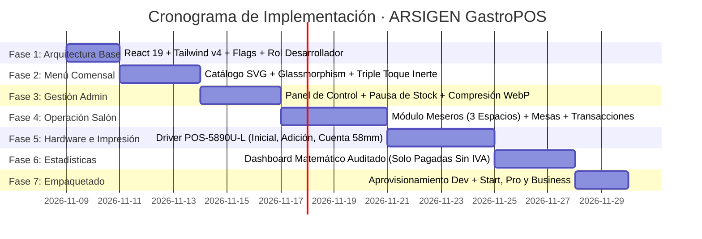

# 🗺️ HOJA DE RUTA Y PLAN DE IMPLEMENTACIÓN (ROADMAP)
## Desarrollo del Motor Gastronómico ARSIGEN & Plantillas Start, Pro y Business

---

### Control del Documento
* **Código:** `ARS-SPEC-RDM-005`
* **Versión:** `1.1.0` (Actualizado según Aclaraciones del Propietario)
* **Estado:** Aprobado para Ejecución
* **Fecha:** 2026-11-08
* **Autor:** Josué Caro (ARSIGEN SAS) & Antigravity Lead Architect
* **Trazabilidad:** Derivado de `ARS-SPEC-SRS-001`, `ARS-SPEC-SAS-002`, `ARS-SPEC-DBS-003` y `ARS-SPEC-BRP-004`

---

## 1. Estrategia de Ejecución: "Construir una vez, empaquetar por tres"

La hoja de ruta se rige bajo el principio de **Ingeniería Modular Acumulativa**. En lugar de construir tres proyectos aislados desde cero, desarrollaremos el **Motor Integral ARSIGEN GastroPOS** con su matriz de *Feature Flags*. 

Una vez que el motor esté probado al 100%, se derivarán y empaquetarán las 3 carpetas de plantillas (`start/`, `pro/`, `business/`) con sus respectivas banderas congeladas, listas para clonar y desplegar en 3 minutos por cada nuevo restaurante cliente.

---

## 2. Cronograma de Fases Secuenciales de Desarrollo

---

### FASE 1: Arquitectura Base, Core Engine y Rol de Desarrollador en Producción
* **Objetivo:** Establecer el andamiaje técnico modular común, la autenticación de desarrollador mediante Cloud Functions y la configuración dinámica de planes.
* **Entregables Clave:**
  * Estructura base de React 19 + TypeScript + Vite + Tailwind CSS v4.
  * Módulo `src/config/capabilities.ts` con la Matriz de Capacidades (`start`, `pro`, `business`).
  * Cloud Function segura para validación de Google OAuth del Desarrollador (sin correos hardcodeados en el cliente).
  * Panel de Desarrollador en producción para alternar planes (`start` $\leftrightarrow$ `pro` $\leftrightarrow$ `business`) y activar/desactivar banderas sin redesplegar.
  * Conexión a Firebase con persistencia local IndexedDB multicapa activada (`persistentLocalCache`).
* **Criterio de Aceptación (DoD):**
  * La aplicación compila con cero advertencias en TypeScript (`tsc --noEmit`).
  * El desarrollador puede cambiar el plan en vivo en `/config/general` y el cliente actualiza sus capacidades de inmediato.

---

### FASE 2: Menú Digital del Comensal & Sistema de Diseño (Base Plan Start)
* **Objetivo:** Construir la experiencia de cara al cliente público con estética *Dark Glassmorphism* ultra-rápida, limpia y minimalista.
* **Entregables Clave:**
  * Categorías renderizadas exclusivamente con **iconos vectoriales SVG predefinidos** (emojis prohibidos).
  * Componentes de presentación limpios (eliminación de `badgeTag` para evitar ruido visual).
  * Menú de solo lectura para Plan Start (sin panel de administración para el cliente y sin enlaces a Google Maps ni redes).
  * Precios netos mostrados con IVA ya incluido (sin cálculos de impuestos).
  * Gatillo silencioso de 3 toques en el logo (`<SecretAccessTrigger />`) sin animaciones en toques 1 y 2.
* **Criterio de Aceptación (DoD):**
  * El menú carga en < 800 ms (LCP verificado en Lighthouse).
  * Toques 1 y 2 en el logo son 100% inertes; el toque 3 abre el modal de acceso del personal.

---

### FASE 3: Panel Administrativo de Menú y Stock (Base Plan Pro)
* **Objetivo:** Dotar al único usuario Administrador de control total e inmediato sobre su carta sin depender de soporte.
* **Entregables Clave:**
  * Autenticación de Administrador vía Google OAuth / Correo (**exactamente 1 usuario admin por restaurante**).
  * Interfaz CRUD de categorías (asignación de SVG) y productos dentro del límite del plan (hasta 50 ítems en Pro).
  * Interruptor táctil de Pausa de Stock (`isAvailable: true/false`) con propagación en menos de 200 ms.
  * Servicio de compresión en cliente de fotos gastronómicas (reducción a WebP < 400 KB antes de subida).
  * Enlaces a redes sociales y botón directo de reseñas en Google Maps.
* **Criterio de Aceptación (DoD):**
  * Un cambio de precio en el panel administrativo se refleja en el menú del comensal y del mesero en tiempo real.
  * El campo `sortOrder` organiza la lista internamente sin mostrar números al comensal.

---

### FASE 4: Módulo de Salón, Mesas y Meseros en 3 Espacios (Base Plan Business)
* **Objetivo:** Operación ágil en salón para toma de pedidos desde celulares o tablets de meseros (sin límite de meseros).
* **Entregables Clave:**
  * Login de meseros por selector de nombre + PIN numérico de 4 a 6 dígitos con rate-limiting.
  * Mapa de mesas con perspectiva simplificada del mesero: **Vacía (Verde)** u **Ocupada (Ámbar/Rojo)**.
  * **Cajón de comanda estructurado en 3 espacios:**
    * *Espacio 1 (Superior):* Barra de búsqueda con autocompletado en tiempo real.
    * *Espacio 2 (Central):* Lista de productos seleccionados con modificadores de cantidad (+ / -) y notas de preparación (*"sin cebolla"*).
    * *Espacio 3 (Inferior):* Selector horizontal de categorías SVG para exploración rápida.
  * Creación atómica de pedidos en Firestore mediante transacciones para evitar colisiones de mesa.
  * Función de "Adición de platos" (rondas) sobre mesas ocupadas y transferencia de mesas vacías.
  * Registro explícito de timestamps: `createdAt` al enviar la comanda.
* **Criterio de Aceptación (DoD):**
  * El mesero no puede ver precios administrativos ni tiene permisos para cobrar o cancelar pedidos.
  * Dos meseros intentando abrir la misma mesa al mismo tiempo resultan en un único ganador sin corrupción de datos.

---

### FASE 5: Recepción en Caja e Impresión Térmica POS-5890U-L (Base Plan Business)
* **Objetivo:** Tablero de despacho para el administrador y conexión con la impresora física térmica de 58 mm.
* **Entregables Clave:**
  * Tablero tripartito de caja: **Vacía**, **Sin Imprimir (Alerta visual pulsante)** y **Ocupada / Impresa**.
  * Driver de hardware `printerService.ts` con conectividad **Web Bluetooth** y cable USB en 32 columnas.
  * **3 Formatos de Impresión Estrictos:**
    1. *Comanda Inicial de Cocina/Barra:* Mesa, mesero, hora, consecutivo, cantidades y notas. Cero precios.
    2. *Comanda de Adición:* Rotulada como `*** COMANDA DE ADICIÓN ***` conteniendo únicamente los ítems de rondas posteriores.
    3. *Pre-cuenta del Cliente:* Membrete, desglose de ítems con precios unitarios (IVA incluido), propina sugerida, total a pagar y leyenda fiscal legal.
  * Timestamps registrados: `printedAt` al emitir comanda y `paidAt` al cobrar.
  * Modal de contingencia y reintento ante atascos, fin de papel o desconexión física.
* **Criterio de Aceptación (DoD):**
  * Al presionar "Imprimir Comanda" desde la tablet de caja, la POS-5890U-L imprime el ticket sin descuadre de márgenes.
  * Al marcar como pagado, la orden queda **permanentemente congelada e inmutable** en Firestore.

---

### FASE 6: Métricas y Estadísticas Financieras Auditadas (Base Plan Business)
* **Objetivo:** Proporcionar al dueño un resumen contable transparente, inmutable y basado en datos reales de caja.
* **Entregables Clave:**
  * Motor de cálculo matemático `AnalyticsCalculator.ts` operando **únicamente sobre `status == 'paid'`**.
  * Cero cálculos o desgloses de IVA (precios netos).
  * Tarjetas KPI de alto impacto: Ventas del día, Ticket Promedio por mesa, Total mensual acumulado.
  * Gráficas de distribución por día de la semana y horas pico.
  * Tablas de ranking de productos por rotación de inventario (volumen) y por facturación ($).
  * Desglose de productividad y ventas generadas por cada mesero.
* **Criterio de Aceptación (DoD):**
  * Los pedidos cancelados o mesas actualmente abiertas no suman ni un solo peso al reporte de ingresos.
  * Las ventas históricas no se alteran ante cambios futuros de precio en el menú.

---

### FASE 7: Aprovisionamiento de Desarrollador, Empaquetado y Plantillas
* **Objetivo:** Flujo de entrega comercial inmediata de las plantillas Start, Pro y Business.
* **Entregables Clave:**
  * Flujo de Aprovisionamiento por Desarrollador: Crear restaurante, dar de alta al único admin, cargar categorías SVG iniciales, platos y mesas antes de entregar al cliente.
  * Generación y prueba de las 3 plantillas en `C:\Users\JOSUE\PROYECTOS\Plantillas para restaurantes\`:
    * `/start`: Pre-configurada con `capabilities.start`.
    * `/pro`: Pre-configurada con `capabilities.pro`.
    * `/business`: Pre-configurada con `capabilities.business`.
  * Verificación estricta de compilación y empaquetado (`npm run build`) en cada una de ellas.
  * Archivo `firestore.rules` desplegado y validado.
* **Criterio de Aceptación (DoD):**
  * Clonar una plantilla para un nuevo cliente, configurarla desde el panel de desarrollador y tenerla funcionando en producción en menos de 5 minutos.
