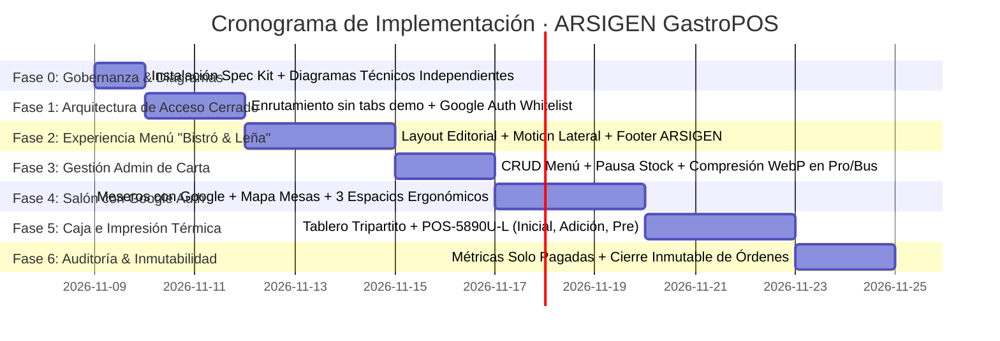

# 🗺️ HOJA DE RUTA Y PLAN DE IMPLEMENTACIÓN (ROADMAP)
## Desarrollo del Motor Gastronómico ARSIGEN & Plantilla Base
### Plantilla Base: "Bistró & Leña · Fuego Sagrado"

---

### Control del Documento
* **Código:** `ARS-SPEC-RDM-005`
* **Versión:** `1.2.0` (Alineado con Iteración 1: GitHub Spec Kit, Google Auth Whitelist & Diagramas Técnicos)
* **Estado:** Aprobado para Ejecución
* **Fecha:** 2026-11-09
* **Autor:** Josué Caro (ARSIGEN SAS) & Antigravity Lead Architect
* **Trazabilidad:** Derivado de `ARS-SPEC-SRS-001`, `ARS-SPEC-SAS-002`, `ARS-SPEC-DBS-003` y `ARS-SPEC-BRP-004`
* **Diagramas Técnicos:** [DIAGRAM_ENTITY_RELATIONSHIP.md](file:///c:/Users/JOSUE/PROYECTOS/Plantilla%20Arsigen/DIAGRAM_ENTITY_RELATIONSHIP.md), [DIAGRAM_SEQUENCE.md](file:///c:/Users/JOSUE/PROYECTOS/Plantilla%20Arsigen/DIAGRAM_SEQUENCE.md), [DIAGRAM_FLOWCHARTS_AND_STATES.md](file:///c:/Users/JOSUE/PROYECTOS/Plantilla%20Arsigen/DIAGRAM_FLOWCHARTS_AND_STATES.md)

---

## 1. Estrategia Metodológica SSD (Spec-Driven Development)

El proyecto se rige de forma inquebrantable bajo el ciclo de desarrollo orientado a especificaciones:
$$\text{Especificación Formal} \longrightarrow \text{Diagramas Técnicos Visuales} \longrightarrow \text{Gobernanza con Spec Kit} \longrightarrow \text{Construcción de Código}$$

**Principio Rector:** Queda prohibida la alteración de archivos de código fuente antes de que las especificaciones, las reglas de negocio, los esquemas de base de datos y los diagramas de flujo hayan sido formalizados y aprobados.

---

## 2. Cronograma de Fases Secuenciales de Desarrollo

---

### FASE 0: Gobernanza de Especificaciones & Diagramación Visual Independiente
* **Objetivo:** Establecer la base documental formal y visual que permita auditar la arquitectura sin ambigüedades.
* **Entregables:**
  * Actualización de los 5 documentos fundacionales (`1_SRS`, `2_SAS`, `3_DBS`, `4_BRP`, `5_ROADMAP`) a versión `1.2.0`.
  * Publicación de los 3 documentos de diagramación técnica independiente:
    1. `DIAGRAM_ENTITY_RELATIONSHIP.md` (Esquema de datos, tipos y restricciones).
    2. `DIAGRAM_SEQUENCE.md` (Secuencias de Auth, Pedidos, Despacho e Impresión).
    3. `DIAGRAM_FLOWCHARTS_AND_STATES.md` (Máquinas de estado de mesas y órdenes).
  * Instalación de `specify-cli` (GitHub Spec Kit) y configuración del directorio `.specify/`.

---

### FASE 1: Arquitectura de Software Cerrado & Google Auth Whitelist
* **Objetivo:** Erradicar la apariencia de demo SaaS pública; garantizar que la URL pública sea únicamente la carta digital y blindar el acceso a personal.
* **Entregables:**
  * Supresión total de botones de perspectiva ("Panel Admin", "Caja & POS", "Salón & Meseros", etc.) y del selector de planes en la navegación pública de `App.tsx`.
  * Colección `/authorized_staff` en Firestore y reglas de seguridad asociadas.
  * Flujo de inicio de sesión discreto vía Google OAuth (gatillo silencioso de 3 toques sobre el logo del restaurante).
  * Verificación estricta de correo en servidor: si el usuario de Google no figura en `/authorized_staff`, se expulsa la sesión y se bloquea el acceso.
  * Consola de Desarrollador protegida exclusivamente para el correo del propietario (`ACT-DEV`), permitiendo conmutar planes (`start` $\leftrightarrow$ `pro` $\leftrightarrow$ `business`) en vivo.

---

### FASE 2: Experiencia Visual Menú "Bistró & Leña · Fuego Sagrado"
* **Objetivo:** Crear una interfaz gastronómica de alto impacto sensorial, eliminando cajas cuadradas genéricas y dotándola de movimiento fluido.
* **Entregables:**
  * Paleta sensorial de brasas (carbón obsidiana `#0d1117`, ámbar fuego `#f59e0b`, cobre `#ea580c`).
  * Carrusel continuo de categorías con scroll lateral suave (`scroll-snap-type: x mandatory`).
  * Microinteracciones con transiciones de entrada y salida suaves (`cubic-bezier(0.16, 1, 0.3, 1)`).
  * Pie de página discreto y elegante con el respaldo tecnológico de ARSIGEN y enlace a `arsigen.com`.
  * Precios netos con IVA incluido (sin cálculos de impuestos).

---

### FASE 3: Panel Administrativo de Carta y Stock (Planes Pro y Business)
* **Objetivo:** Autonomía operativa para el Administrador único del restaurante.
* **Entregables:**
  * CRUD de categorías con asignación de iconos vectoriales SVG limpios (emojis prohibidos).
  * Alta y edición de productos dentro del tope del plan (50 en Pro, ilimitado en Business).
  * Pausa táctil de stock (`isAvailable: true/false`) con propagación en tiempo real.
  * Compresión en cliente de imágenes gastronómicas a formato WebP (< 400 KB).

---

### FASE 4: Operación de Salón y Meseros con Google Auth (Plan Business)
* **Objetivo:** Toma de pedidos ágil desde dispositivos móviles personales de los meseros.
* **Entregables:**
  * Inicio de sesión de meseros mediante su cuenta Google personal autorizada en `authorized_staff`.
  * Mapa de mesas con perspectiva simplificada: **Vacía (Verde)** u **Ocupada (Ámbar/Rojo)**.
  * Drawer de comanda estructurado en 3 espacios ergonómicos:
    1. *Buscador superior predictivo.*
    2. *Bandeja central de ítems con notas de preparación y cantidades.*
    3. *Barra inferior de categorías SVG.*
  * Adición de nuevas rondas a mesas ocupadas con bandera `isAddedRound: true`.

---

### FASE 5: Recepción en Caja e Impresión Térmica POS-5890U-L (Plan Business)
* **Objetivo:** Tablero de despacho en vivo y conexión física de impresión térmica en 58 mm.
* **Entregables:**
  * Tablero tripartito de caja: **Vacía**, **Sin Imprimir (Alerta destacada)** y **Ocupada / Impresa**.
  * Driver ESC/POS para POS-5890U-L (32 columnas monoespaciadas).
  * **3 Plantillas de Impresión:**
    1. *Comanda Inicial de Cocina/Barra (sin precios).*
    2. *Comanda de Adición (únicamente platos nuevos).*
    3. *Pre-cuenta del Cliente (precios unitarios con IVA incluido y propina voluntaria sugerida).*
  * Registro de timestamps: `printedAt` y `paidAt`.
  * Congelamiento inmutable permanente de la orden una vez cobrada.

---

### FASE 6: Métricas y Auditoría Financiera
* **Objetivo:** Panel contable transparente y verídico basado en transacciones pagadas.
* **Entregables:**
  * Motor de cálculo matemático auditado sobre órdenes con `status == 'pagada'`.
  * Ventas del día, ticket promedio, ventas del mes y ranking de productos por rotación e ingresos.
  * Rendimiento de turnos por mesero.
