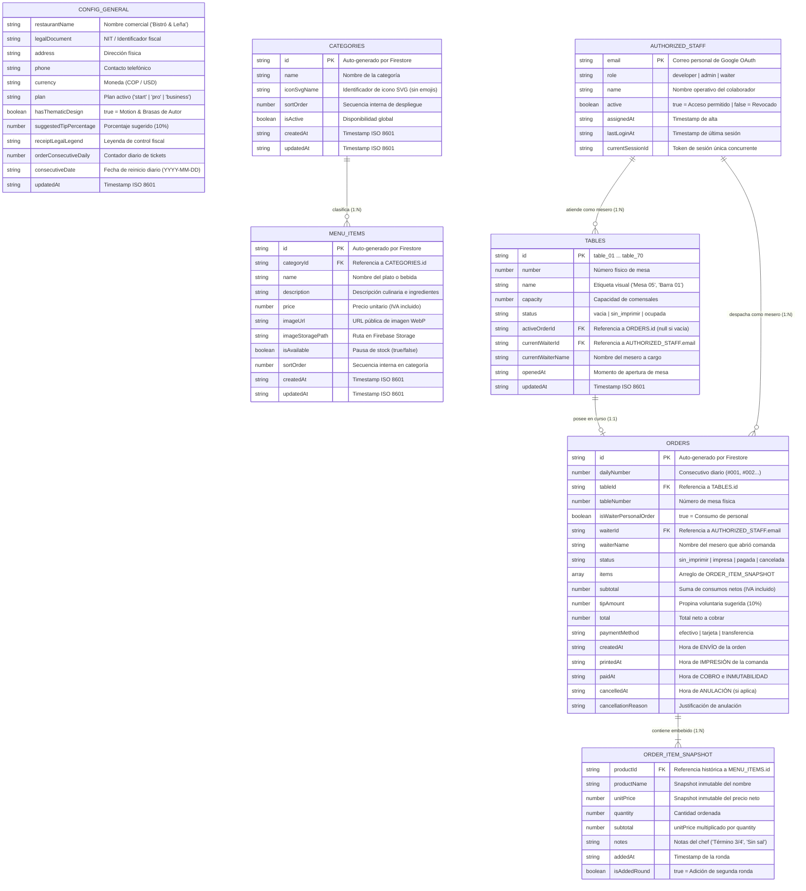

# 📊 DIAGRAMA ENTIDAD-RELACIÓN Y ESPECIFICACIÓN DE DATOS (ERD)
## Ecosistema Gastronómico ARSIGEN · Cloud Firestore Database Model
### Plantilla Base: "Bistró & Leña · Fuego Sagrado"

---

### Control del Documento
* **Código:** `ARS-DIAG-ERD-001`
* **Versión:** `1.0.0`
* **Estado:** Aprobado para Auditoría y Construcción
* **Fecha:** 2026-11-09
* **Autor:** Josué Caro (ARSIGEN SAS) & Antigravity Lead Architect
* **Documento Vinculado:** [3_DATABASE_SPECIFICATION.md](file:///c:/Users/JOSUE/PROYECTOS/Plantilla%20Arsigen/3_DATABASE_SPECIFICATION.md)

---

## 1. Diagrama Entidad-Relación Global (Mermaid ERD)

---

## 2. Diccionario de Datos Exhaustivo

### 2.1. Colección `/config/general` (Singleton)
Ruta: `/config/general` · Un solo documento por restaurante.

| Campo | Tipo Firestore | Nulo | Restricciones / Valores Permitidos | Descripción Funcional |
|---|---|:---:|---|---|
| `restaurantName` | `string` | No | Longitud 2-60 caracteres | Nombre comercial para el encabezado y tickets. |
| `legalDocument` | `string` | No | Formato NIT o RUT fiscal | Identificador tributario del restaurante. |
| `address` | `string` | No | Texto legible | Ubicación física para el pie del recibo. |
| `phone` | `string` | No | E.164 o local | Número telefónico de atención. |
| `currency` | `string` | No | `'COP'` \| `'USD'` | Símbolo y formato de moneda. |
| `plan` | `string` | No | `'start'` \| `'pro'` \| `'business'` | Plan contratado; define las capacidades del motor. |
| `hasThematicDesign` | `boolean` | No | `true` \| `false` | Activa diseño temático de autor y motion de brasas. |
| `suggestedTipPercentage` | `number` | No | $\ge 0$ (default: 10) | Porcentaje de propina voluntaria en pre-cuenta. |
| `receiptLegalLegend` | `string` | No | Texto estático | Leyenda de no validez fiscal del recibo de consumo. |
| `orderConsecutiveDaily` | `number` | No | Entero positivo $\ge 1$ | Consecutivo numérico reiniciable diariamente. |
| `consecutiveDate` | `string` | No | `YYYY-MM-DD` | Fecha testigo para el reinicio automático del consecutivo. |
| `updatedAt` | `string` | No | ISO 8601 | Fecha de última actualización de la configuración. |

---

### 2.2. Colección `/categories`
Ruta: `/categories/{categoryId}` · Catálogo de agrupadores.

| Campo | Tipo Firestore | Nulo | Restricciones / Valores Permitidos | Descripción Funcional |
|---|---|:---:|---|---|
| `id` | `string` | No | Auto-ID Firestore | Clave primaria de la categoría. |
| `name` | `string` | No | Longitud 2-40 caracteres | Nombre visual (Ej: "Cortes a la Brasa"). |
| `iconSvgName` | `string` | No | Identificador SVG estandarizado | Clave del icono vectorial. **Emojis prohibidos**. |
| `sortOrder` | `number` | No | Entero $\ge 0$ | Orden de visualización interna. **Oculto al comensal**. |
| `isActive` | `boolean` | No | `true` \| `false` | Permite deshabilitar la categoría entera. |
| `createdAt` | `string` | No | ISO 8601 | Momento de creación. |
| `updatedAt` | `string` | No | ISO 8601 | Momento de última edición. |

---

### 2.3. Colección `/menu_items`
Ruta: `/menu_items/{itemId}` · Catálogo unificado para comensales y meseros.

| Campo | Tipo Firestore | Nulo | Restricciones / Valores Permitidos | Descripción Funcional |
|---|---|:---:|---|---|
| `id` | `string` | No | Auto-ID Firestore | Clave primaria del plato o bebida. |
| `categoryId` | `string` | No | FK existente en `/categories` | Categoría a la que pertenece el producto. |
| `name` | `string` | No | Longitud 2-60 caracteres | Nombre del producto. |
| `description` | `string` | No | Longitud 5-300 caracteres | Ingredientes, alérgenos o descripción sensorial. |
| `price` | `number` | No | Entero $\ge 0$ (IVA incluido) | Precio neto al comensal. Cero cálculo de impuestos. |
| `imageUrl` | `string` | No | URL válida (Storage o WebP) | Fotografía del producto. |
| `imageStoragePath` | `string` | Sí | Ruta de Firebase Storage | Ruta para eliminación de archivo físico al actualizar. |
| `isAvailable` | `boolean` | No | `true` \| `false` | Pausa de stock en 1 toque. |
| `sortOrder` | `number` | No | Entero $\ge 0$ | Orden secuencial interno en la categoría. |
| `createdAt` | `string` | No | ISO 8601 | Momento de alta del producto. |
| `updatedAt` | `string` | No | ISO 8601 | Momento de última modificación. |

---

### 2.4. Colección `/tables` (Plan Business)
Ruta: `/tables/{tableId}` · Estado físico de salón (hasta 70 mesas).

| Campo | Tipo Firestore | Nulo | Restricciones / Valores Permitidos | Descripción Funcional |
|---|---|:---:|---|---|
| `id` | `string` | No | `table_01` a `table_70` | Clave primaria de la mesa física. |
| `number` | `number` | No | Entero $1 \dots 70$ | Número visual impreso en la mesa. |
| `name` | `string` | No | Longitud 2-30 caracteres | Etiqueta para el personal (Ej: "Mesa 05"). |
| `capacity` | `number` | No | Entero $1 \dots 20$ | Cantidad promedio de comensales por mesa. |
| `status` | `string` | No | `'vacia'` \| `'sin_imprimir'` \| `'ocupada'` | Estado operativo tripartito de caja. |
| `activeOrderId` | `string` | Sí | FK en `/orders` (o `null`) | ID de la comanda activa asociada. |
| `currentWaiterId` | `string` | Sí | FK en `/authorized_staff` | Email del mesero que abrió la comanda. |
| `currentWaiterName` | `string` | Sí | Texto o `null` | Nombre legible del mesero a cargo. |
| `openedAt` | `string` | Sí | ISO 8601 o `null` | Hora en que se abrió la mesa con su primer pedido. |
| `updatedAt` | `string` | No | ISO 8601 | Último cambio de estado de la mesa. |

---

### 2.5. Colección `/orders` (Plan Business)
Ruta: `/orders/{orderId}` · Comanda de preparación, recibo e histórico contable inmutable.

| Campo | Tipo Firestore | Nulo | Restricciones / Valores Permitidos | Descripción Funcional |
|---|---|:---:|---|---|
| `id` | `string` | No | Auto-ID Firestore | Clave primaria de la orden. |
| `dailyNumber` | `number` | No | Entero $\ge 1$ | Consecutivo diario correlativo (#001...). |
| `tableId` | `string` | No | FK en `/tables` | Mesa física asignada. |
| `tableNumber` | `number` | No | Entero $\ge 0$ | Número de mesa (0 si es pedido de personal). |
| `isWaiterPersonalOrder`| `boolean` | No | `true` \| `false` | Indica si es un pedido "A su nombre" sin mesa física. |
| `waiterId` | `string` | No | FK en `/authorized_staff` | Correo Google del mesero responsable. |
| `waiterName` | `string` | No | Texto legible | Nombre del mesero para el ticket de cocina. |
| `status` | `string` | No | `'sin_imprimir'` \| `'impresa'` \| `'pagada'` \| `'cancelada'` | Ciclo de vida operativo de la orden. |
| `items` | `array` | No | Lista de objetos `OrderItemSnapshot` | Detalle inmutable de platos solicitados. |
| `subtotal` | `number` | No | $\ge 0$ (IVA incluido) | Suma exacta de subtotales de ítems. |
| `tipAmount` | `number` | No | $\ge 0$ | Propina sugerida voluntaria (si el cliente acepta). |
| `total` | `number` | No | $\text{subtotal} + \text{tipAmount}$ | Valor final recaudado en caja. |
| `paymentMethod` | `string` | Sí | `'efectivo'` \| `'tarjeta'` \| `'transferencia'` | Medio de pago registrado en caja. |
| `createdAt` | `string` | No | ISO 8601 | Marca de tiempo exacta de **ENVÍO** por el mesero. |
| `printedAt` | `string` | Sí | ISO 8601 o `null` | Marca de tiempo exacta de **IMPRESIÓN** de la comanda. |
| `paidAt` | `string` | Sí | ISO 8601 o `null` | Marca de tiempo exacta de **PAGO Y CONGELAMIENTO**. |
| `cancelledAt` | `string` | Sí | ISO 8601 o `null` | Marca de tiempo exacta de **ANULACIÓN** (si ocurrió). |
| `cancellationReason` | `string` | Sí | Longitud $\ge 5$ caracteres | Motivo obligatorio exigido al administrador al anular. |

---

### 2.6. Colección `/authorized_staff` (Seguridad Google Auth Whitelist)
Ruta: `/authorized_staff/{email}` · Whitelist de personal autorizado.

| Campo | Tipo Firestore | Nulo | Restricciones / Valores Permitidos | Descripción Funcional |
|---|---|:---:|---|---|
| `email` (Doc ID) | `string` | No | Correo válido Gmail / Google | Clave primaria y correo con el que se autentica en Google. |
| `role` | `string` | No | `'developer'` \| `'admin'` \| `'waiter'` | Rol jerárquico asignado en la aplicación. |
| `name` | `string` | No | Longitud 2-50 caracteres | Nombre visual para los tickets y turnos de salón. |
| `active` | `boolean` | No | `true` \| `false` | Interruptor maestro de acceso (permite suspender personal). |
| `assignedAt` | `string` | No | ISO 8601 | Fecha y hora en que se otorgó el acceso. |
| `lastLoginAt` | `string` | Sí | ISO 8601 o `null` | Registro de última sesión exitosa. |
| `currentSessionId` | `string` | Sí | Token aleatorio UUID | Mecanismo de desalojo forzoso de sesión concurrente. |

---

## 3. Invariantes de Seguridad y Reglas de Integridad

1. **Inmutabilidad Absoluta de Órdenes Pagadas:** Una vez que `status == 'pagada'`, el documento queda blindado en Firestore. Las reglas de seguridad rechazan cualquier petición de actualización (`update`) o eliminación (`delete`) sin excepción.
2. **Precios con IVA Incluido:** Todos los precios residen como valores netos. Queda terminantemente prohibido desglosar bases gravables o calcular tasas de impuesto en los cálculos matemáticos o en los tickets térmicos.
3. **Uso Exclusivo de Iconos Vectoriales SVG:** En `/categories`, el campo `iconSvgName` debe coincidir con un icono del catálogo vectorizado interno; los emojis están expresamente prohibidos en la base de datos.
4. **Reserva Atómica de Mesas:** La asignación de comanda a una mesa se realiza mediante transacciones de Firestore (`runTransaction`), impidiendo que dos meseros abran la misma mesa simultáneamente.
