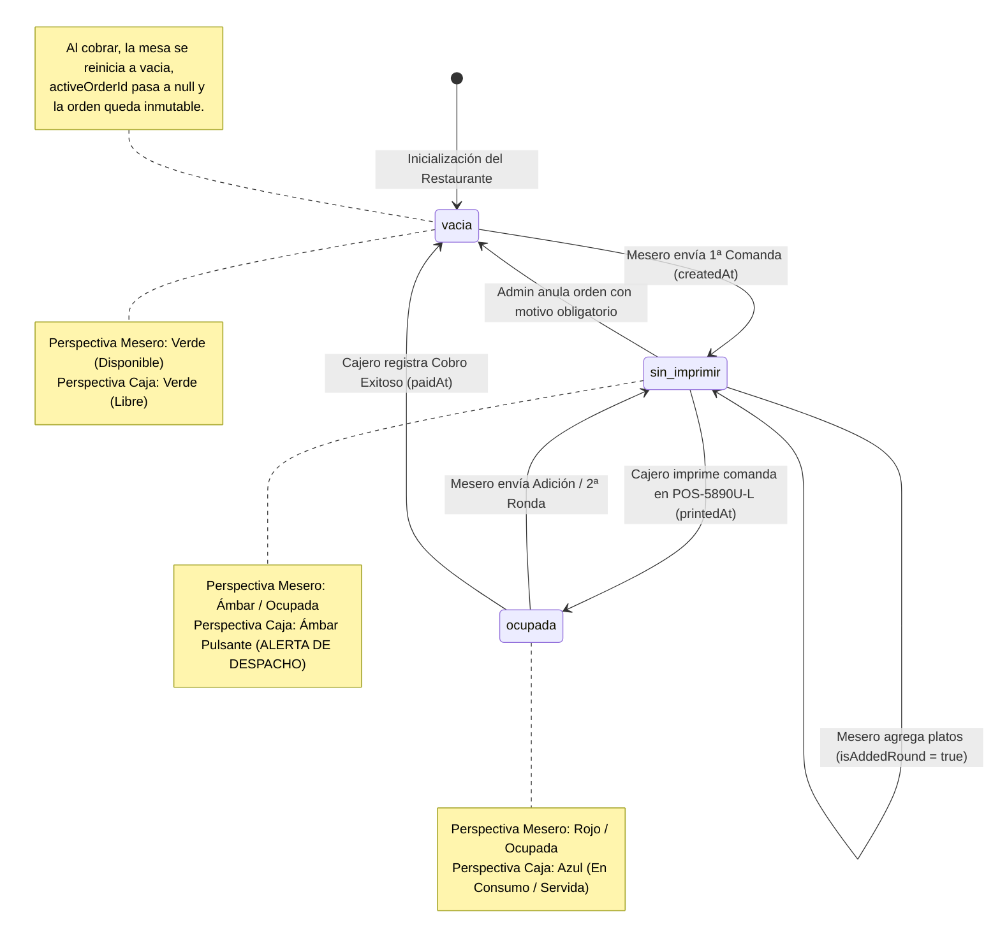
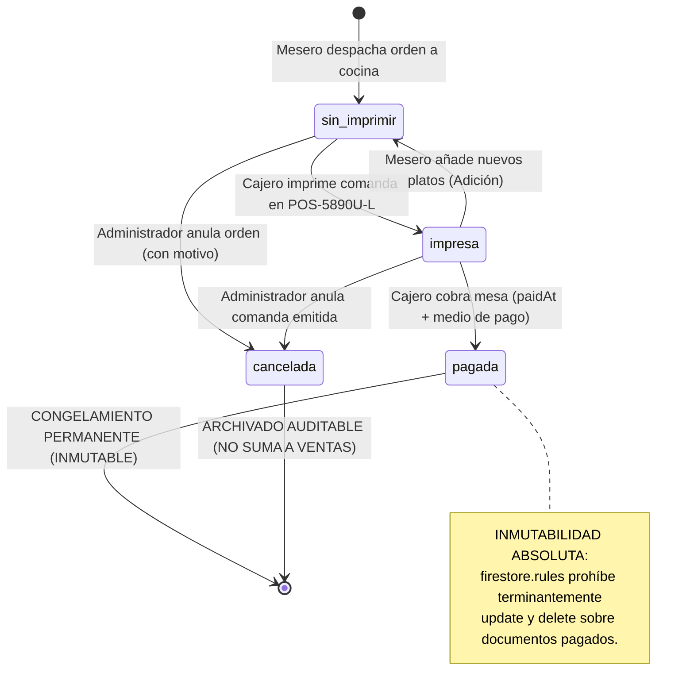
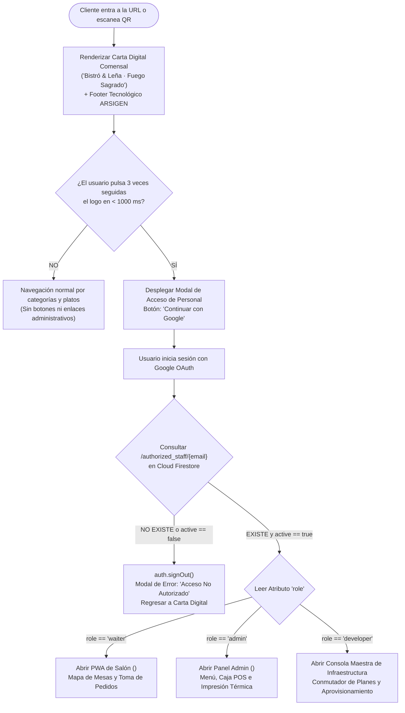
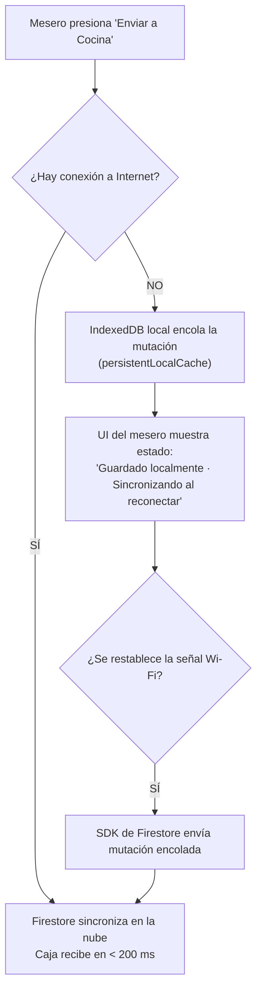
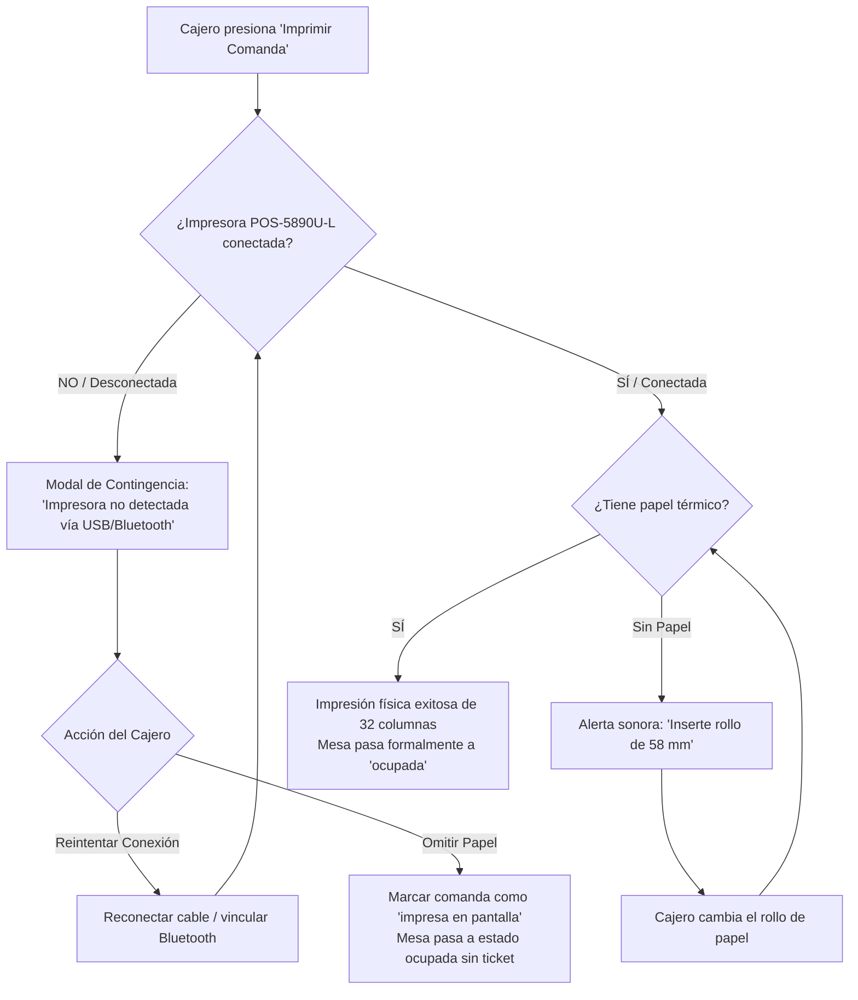
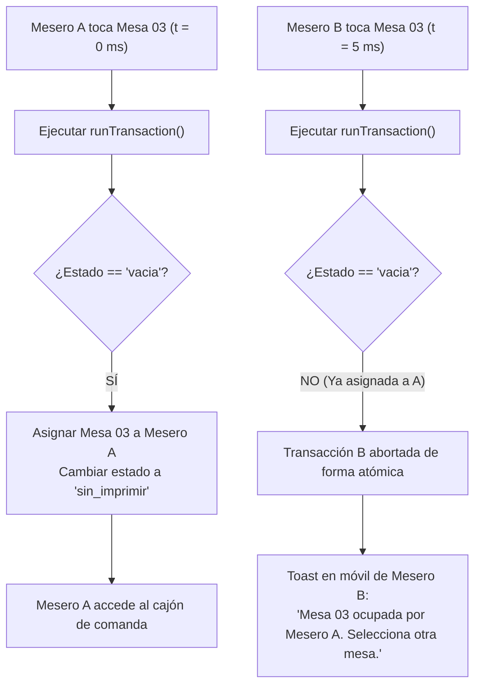

# 🔀 DIAGRAMAS DE FLUJO Y MÁQUINAS DE ESTADOS
## Lógica Operativa, Ciclos de Vida y Manejo de Excepciones · ARSIGEN GastroPOS
### Plantilla Base: "Bistró & Leña · Fuego Sagrado"

---

### Control del Documento
* **Código:** `ARS-DIAG-FLO-003`
* **Versión:** `1.0.0`
* **Estado:** Aprobado para Auditoría y Construcción
* **Fecha:** 2026-11-09
* **Autor:** Josué Caro (ARSIGEN SAS) & Antigravity Lead Architect
* **Documentos Vinculados:** [1_SOFTWARE_REQUIREMENTS_SPECIFICATION.md](file:///c:/Users/JOSUE/PROYECTOS/Plantilla%20Arsigen/1_SOFTWARE_REQUIREMENTS_SPECIFICATION.md) y [4_BUSINESS_RULES_AND_PERMISSIONS.md](file:///c:/Users/JOSUE/PROYECTOS/Plantilla%20Arsigen/4_BUSINESS_RULES_AND_PERMISSIONS.md)

---

## 1. Máquina de Estados: Ciclo de Vida de Mesas Físicas (`/tables`)

El estado de cada una de las mesas físicas transiciona a través de eventos operativos ejecutados por los meseros y el cajero.

### Tabla Formal de Transiciones de Mesa:

| Estado Actual | Evento Disparador | Actor | Nuevo Estado | Efecto Colateral en el Sistema |
|---|---|---|---|---|
| `vacia` | `CREAR_PRIMERA_COMANDA` | Mesero | `sin_imprimir` | Asigna `activeOrderId`, genera `createdAt`, alerta visual en caja (<200ms). |
| `sin_imprimir` | `IMPRIMIR_COMANDA_INICIAL` | Admin/Cajero | `ocupada` | Emite ticket físico en POS-5890U-L, registra `printedAt`. |
| `ocupada` | `ENVIAR_ADICION_RONDA` | Mesero | `sin_imprimir` | Ítems marcados con `isAddedRound: true`, alerta de adición en caja. |
| `sin_imprimir` | `IMPRIMIR_ADICION` | Admin/Cajero | `ocupada` | Emite ticket parcial `*** COMANDA DE ADICIÓN ***`. |
| `ocupada` | `REGISTRAR_PAGO` | Admin/Cajero | `vacia` | Congela orden con `status = 'pagada'` y `paidAt`, desasigna mesa. |
| `sin_imprimir` | `ANULAR_ORDEN` | Admin | `vacia` | Exige `cancellationReason`, marca orden como `cancelada`, libera mesa. |

---

## 2. Máquina de Estados: Ciclo de Vida de Órdenes y Facturación (`/orders`)

Garantiza la inmutabilidad tributaria y financiera sin permitir alteraciones retroactivas.

---

## 3. Diagrama de Flujo: Control de Acceso y Enrutamiento (Software Cerrado)

Determina de forma binaria si el visitante visualiza la carta digital o si accede a los módulos protegidos.

---

## 4. Diagramas de Flujo de Tolerancia a Fallos y Excepciones

### 4.1. Tolerancia a Pérdida de Conexión en Salón (Modo Offline)

### 4.2. Tolerancia a Fallos de Impresora Térmica POS-5890U-L

### 4.3. Prevención de Condiciones de Carrera (Dos Meseros en la Misma Mesa)

