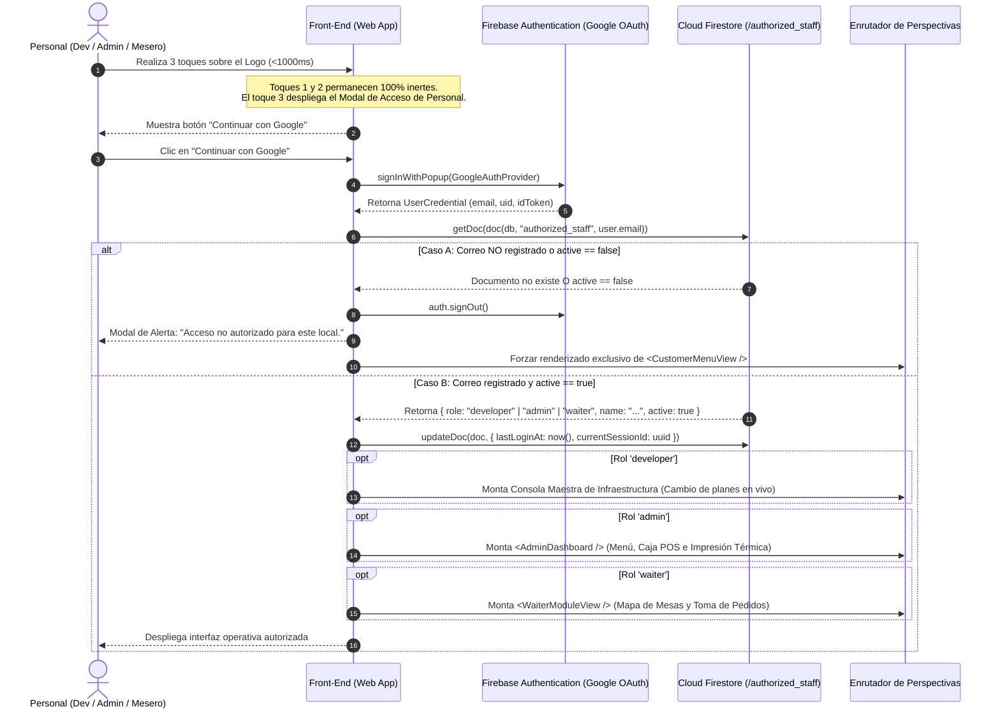
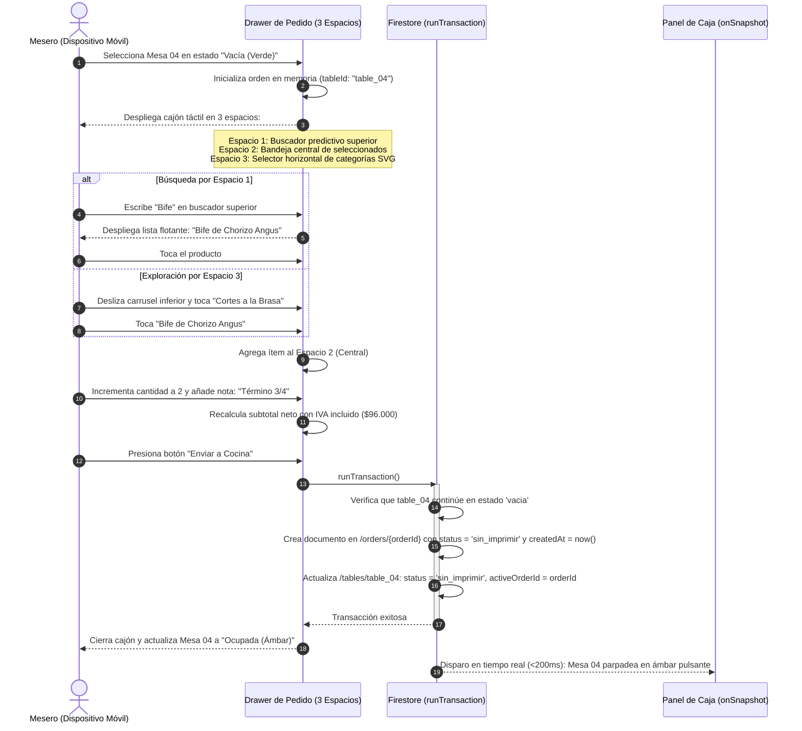
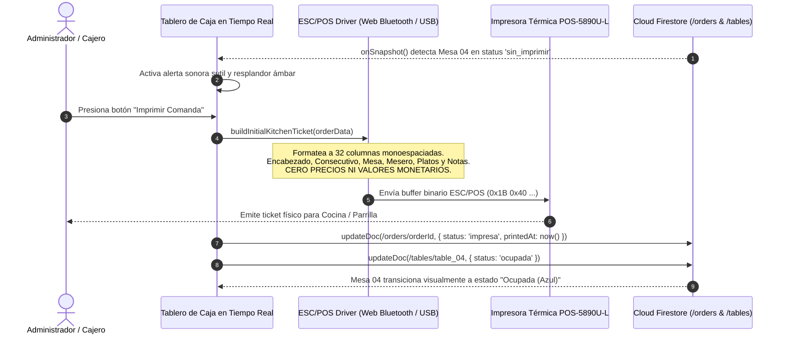
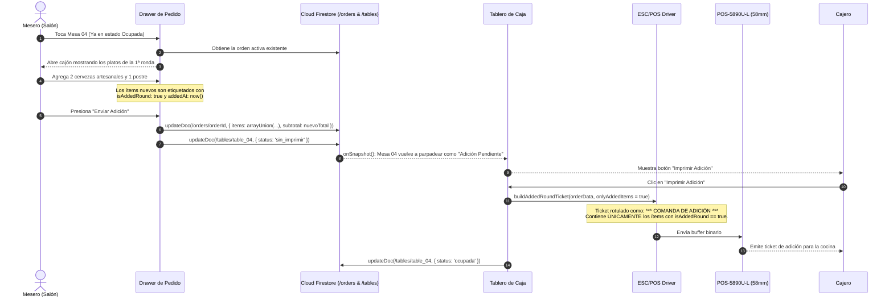
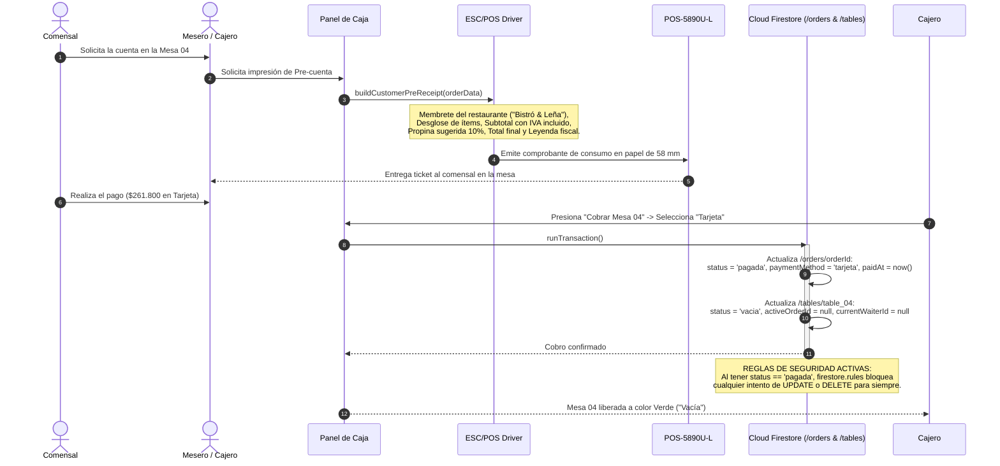
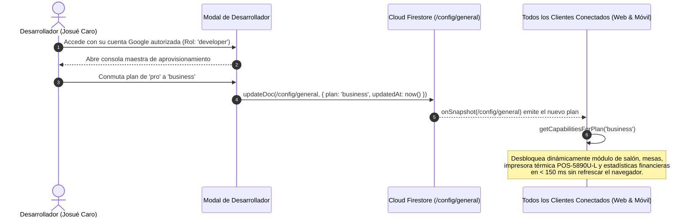

# 🔄 DIAGRAMAS DE SECUENCIA OPERATIVA (UML SEQUENCE)
## Ecosistema Gastronómico ARSIGEN · Single-Core Modular Engine
### Plantilla Base: "Bistró & Leña · Fuego Sagrado"

---

### Control del Documento
* **Código:** `ARS-DIAG-SEQ-002`
* **Versión:** `1.0.0`
* **Estado:** Aprobado para Auditoría y Construcción
* **Fecha:** 2026-11-09
* **Autor:** Josué Caro (ARSIGEN SAS) & Antigravity Lead Architect
* **Documentos Vinculados:** [1_SOFTWARE_REQUIREMENTS_SPECIFICATION.md](file:///c:/Users/JOSUE/PROYECTOS/Plantilla%20Arsigen/1_SOFTWARE_REQUIREMENTS_SPECIFICATION.md) y [2_SOFTWARE_ARCHITECTURE_SPECIFICATION.md](file:///c:/Users/JOSUE/PROYECTOS/Plantilla%20Arsigen/2_SOFTWARE_ARCHITECTURE_SPECIFICATION.md)

---

## 1. Secuencia 1: Handshake de Autenticación con Google y Verificación Whitelist

Muestra cómo el personal accede al sistema mediante un punto de entrada discreto y cómo el servidor rechaza cualquier cuenta no autorizada.

---

## 2. Secuencia 2: Toma de Comanda por Mesero en 3 Espacios Ergonómicos

Ilustra la selección de una mesa vacía, la interacción táctil en la pantalla dividida en tres zonas y el despacho atómico de la orden hacia cocina/caja.

---

## 3. Secuencia 3: Detección en Caja e Impresión de Comanda Inicial (POS-5890U-L)

Muestra la recepción reactiva en la tablet de caja y el envío de comandos ESC/POS a la impresora térmica física de 58 mm.

---

## 4. Secuencia 4: Adición de Segunda Ronda de Platos (`isAddedRound`)

Describe qué ocurre cuando los comensales ya sentados piden más platos o bebidas más tarde.

---

## 5. Secuencia 5: Pre-cuenta, Cobro y Congelamiento Inmutable

Muestra la solicitud de cuenta por parte del cliente, la emisión del comprobante con IVA ya incluido, el registro del pago y el sellado permanente de la orden.

---

## 6. Secuencia 6: Conmutación de Plan en Vivo por el Desarrollador

Demuestra cómo el Desarrollador (`caro11josue@gmail.com`) cambia el plan contratado (`start` $\leftrightarrow$ `pro` $\leftrightarrow$ `business`) en tiempo real sin requerir redespliegue de código.

